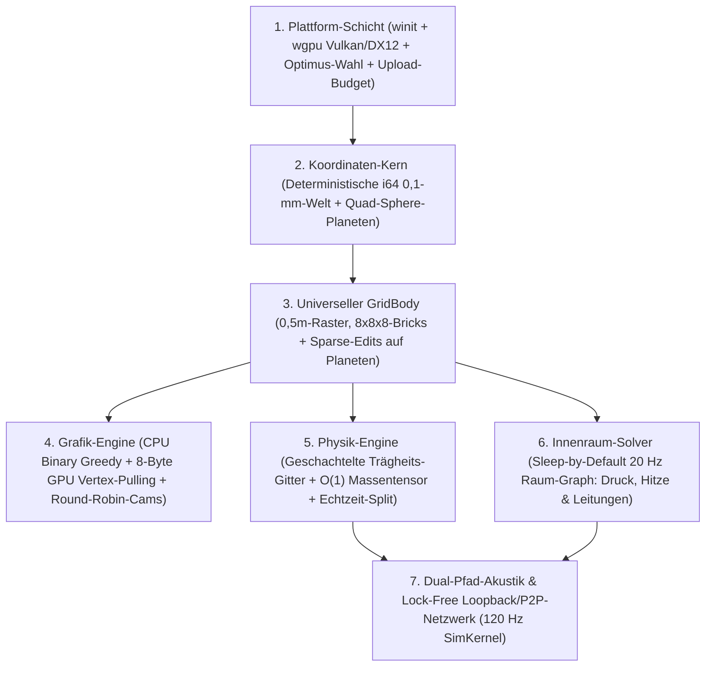

# Engine- & Spielkonzept: Raumfahrt-Sandbox für Linux & Windows (ThinkPad-60-FPS-Referenz)

Dieses Dokument bündelt das vollständige Architektur- und Spielkonzept einer maßgeschneiderten **Pure-Rust-Game-Engine** für ein nahtloses **Single- und Drop-In-Multiplayer-Raumfahrtspiel** — gezielt ausgelegt auf **stabile `60 FPS @ 1080p`** bereits auf Laptop-Hardware der Klasse **Lenovo ThinkPad T480 (Core i5/i7-U, GeForce MX150 `2 GB` / PCIe x2 sowie im Akkubetrieb auf integrierten Intel-UHD-/AMD-iGPUs)** unter Linux und Windows.

---

## 1. Unverrückbare Design-Säulen (Das Fundament)

1. **100 % Raumfahrtzeitalter ab Sekunde 1 (Kein Epochen-Mix):**
   * Keine Steinzeit- oder Mittelalter-Vorphase. Alle Spieler starten im Druckanzug mit Helmlampe, Funkgerät und Montage-Werkzeug.
   * **Drop-In-Koop ohne Bruch:** Neue Spieler können jederzeit einer laufenden Welt beitreten, spawnen direkt in einer freien Koje der Station/Basis und sind ab der ersten Minute vollwertige Crew-Mitglieder (als Pilot, Bordingenieur oder beim Bau eigener kleiner Schiffe).
   * Fortschritt entsteht nicht über Charakter-Level oder Zeitalter, sondern über **Ingenieurs-Maßstab, Logistik, Treibstoff-Infrastruktur und Reichweite** im Sonnensystem.

2. **Minecraft-/LEGO-Kreativität statt Fortnite-Fertigmodulen (`0,5 m`-Raster):**
   * **Keine vorgefertigten „Bedeutungs-Teile“** (keine Fertig-Hauswände, Fertig-Dächer oder starren Stations-Röhren), die dem Spieler vorschreiben, wie ein Gebäude oder Schiff auszusehen hat.
   * Gebaut wird auf einem **festen, durchgehenden `0,5 m`-3D-Raster** (der `1,80 m` große Spieler ist `3,6` Blöcke hoch) aus **bedeutungsoffenen Roh-Blöcken** (Stahl, Stein, Holz, Panzerglas, Keramik-Hitzeschild in Grundformen wie Würfel, Platte, Keil, Ecke).
   * Ob ein Spieler ein gemütliches Haus am See auf der Erde, eine verwinkelte Raumstation im Orbit oder einen asymmetrischen Frachter baut: Alles entsteht aus denselben freien Grundatomen — und mehrere Spieler können von verschiedenen Ecken aus bauen und treffen sich in der Mitte millimetergenau im Raster.

3. **Das „LEGO-Technic“-Prinzip für Funktionsbauteile (im selben `0,5 m`-Raster):**
   * **Feste Mehrblock-Maschinen (`> 1 Block`):** Da der Spieler größer als ein einzelner Block ist, belegen funktionale Stationen feste, glaubwürdige `0,5 m`-Raster-Volumina (`B × H × T`, z. B. Lichtbogen-Schmelze `2×2×3`, Fertigungsbank `2×1×2`, Elektrolyse-Raffinerie `2×2×3`, Luftschleuse `2×2×4`, Pilotensitz, Phosphor-Flugkonsole, Andockring, Spawn-Koje).
   * **Im Raster skalierbare Funktionsblöcke (`B × H × T` variabel):** Bauteile wie **Thruster**, **Treibstofftanks** und **Radiatoren** werden in ganzen `0,5 m`-Schritten skaliert:
     * *Thruster-Geometrie bestimmt Physik:* Großer Querschnitt = hoher Schub (Planetenstart); lange Düsenform = hohe Effizienz/$I_{sp}$ (Langstrecke im Vakuum).
     * *Tanks:* Echte dynamische Masse — leere Tanks machen das Schiff leichter und verschieben live den Schwerpunkt.
   * **Speicherung über Anker + Stellvertreter-Zellen:** Eine Anker-Zelle hält Typ, Orientierung und `(B, H, T)` und rendert das eine Modell; die übrigen belegten Rasterzellen verweisen auf den Anker (blockieren Kollision/Bauplatz und leiten Abbau direkt an den Anker weiter).

4. **Kompromisslose Diegese (Keine „Gott-Kamera“):**
   * Raumschiffe werden nicht aus einer magischen Drittperson-Außenkamera geflogen, sondern über echte, am Rumpf montierte **Bordkameras** (Phosphor-Monitore für Bug, Bauch/Landung, Heck, Teleskop), Fenster und Instrumente.
   * Sprache und Klang folgen echter Physik (Atmosphäre, Kabinendruck, Funkreichweite, Helm-Berührung im Vakuum).

5. **100 % Nativ & Laptop-Effizient auf Linux & Windows (Einzel-Binary):**
   * Reine Rust-Codebasis ohne C++-SDK-Zwang.
   * Ein einziges Binary läuft nativ unter **Linux** (Wayland/X11/SteamOS via Vulkan, inkl. NVIDIA-Optimus-Hybridgrafik) und **Windows** (DirectX 12 / Vulkan) sowie mit `--headless` als dedizierter Server und deterministischer Test-Runner.
   * **Hardware-Zielmarke:** Dauerhaft `60 FPS @ 1920×1080` bei `< 250 MB` VRAM-Bedarf und ohne Thermal-Throttling auf einem **ThinkPad T480 (Core i5/i7-8xxxU + GeForce MX150 `2 GB` / Intel UHD 620)**.

---

## 2. Die 7 Schichten der Engine-Architektur

### Schicht 1: Plattform-Abstraktion & Laptop-Thermikschutz (Linux & Windows)
* **Grafik:** `wgpu` mit einheitlichen `WGSL`-Shadern (Linux $\rightarrow$ Vulkan; Windows $\rightarrow$ DirectX 12 / Vulkan).
* **Hybrid-GPU-Umschalter (Optimus):** Konfigurierbare Adapterwahl zwischen dedizierter GPU (`HighPerformance`, z. B. MX150 am Netzteil) und integrierter GPU (`LowPower`, z. B. Intel UHD 620 unterwegs im Akkubetrieb).
* **Gedrosselter PCIe-Upload-Ringbuffer (`<= 1,5 MB / Frame`):** Verhindert Nachlade-Ruckler auf schmal angebundenen Mobil-GPUs (wie PCIe 3.0 x2 beim T480).
* **Striktes Frame-Pacing (`60 Hz` Cap / `Fifo` + Idle-Sleep in Menüs):** Verhindert unnötige 100-%-Dauerlast und hält Laptop-Kühlsysteme dauerhaft unter der Throttling-Schwelle.
* **Fenster & Audio:** `winit` (Raw-Mouse-Input) + lock-freier PCM-Ringbuffer auf `PipeWire`/`ALSA` (Linux) und `WASAPI` (Windows).

### Schicht 2: Deterministischer `i64`-Koordinatenkern & Kugel-Planeten
* **Kein `f32` für Weltpositionen:** Alle kosmischen Koordinaten sind 64-Bit-Festkommazahlen (`i64` in `0,1 mm`-Schritten $\rightarrow$ $\pm 920\text{ Mio. km}$ ohne Rundungszittern).
* **Cross-OS-Determinismus:** Ganzzahl-Kinematik und festpunktbasierte Kepler-Bahnen liefern unter Linux und Windows bit-identische Ergebnisse.
* **Kamera-relativer Ursprung:** Erst unmittelbar vor dem GPU-Upload wird `delta = objekt_i64 - kamera_i64` gebildet und lokal in `f32` gewandelt.
* **Quad-Sphere-Planeten MIT Baugitter:** Planeten bestehen aus 6 sanft auf eine Kugel projizierten `0,5 m`-Gitter-Schalen. Aus dem Orbit sind sie echte runde Kugeln; am Boden ist das Raster lokal rechtwinklig für nahtloses Bauen wie in Minecraft.

### Schicht 3: Universeller `GridBody` (`0,5 m`-Raster & Sparse Planet Edits)
* **Einheitliches `0,5 m`-Raster für Schiff, Station und Haus:** Spart gegenüber einem `0,25 m`-Raster 87,5 % (`8×`) Volumenspeicher und 75 % (`4×`) Meshing-/PCIe-Last — optimal für Laptops mit `8–16 GB` RAM.
* **Cache-dichte `8×8×8`-Brick-Arenen (`4 m × 4 m × 4 m`):** Flache Arrays + `u64`-Belegungsmasken ohne Einzel-Heap-Allokationen; Roh-Blöcke, feste Mehrblock-Maschinen (`Anchor` + `Proxy`) und skalierte Thruster/Tanks wohnen im selben Gitter.
* **„Sparse Edits Only“ auf Planeten:** Unberührte Planetenlandschaften belegen **`0 Bytes` Brick-RAM** und werden rein aus der Seed-Höhenfunktion als schlankes Clipmap-Gitter gezeichnet; echte `8×8×8`-Bricks entstehen erst dort, wo Spieler graben, bauen oder Krater hinterlassen.

### Schicht 4: Grafik-Engine (Binary Greedy Meshing + `8-Byte` GPU Vertex-Pulling)
* **CPU Binary Greedy Meshing (`~20 µs` pro Brick):** Statt bandbreitenhungrigem Vollbild-Raymarching fasst ein Worker-Thread geänderte `8×8×8`-Bricks per `u64`-Bit-Operationen zu rechteckigen Außenflächen zusammen.
* **`8-Byte` Packed Quads via GPU Vertex-Pulling (`< 250 MB` Gesamt-VRAM):** Jede sichtbare Wandfläche ist nur ein einziges `u64` (`8 Bytes`: lokale Position, `B×H`, Normalen-Index, Material, 4× 2-Bit Eck-AO) statt `184 Bytes` klassischer Vertex-/Index-Daten (**23× kleiner**). Nutzt den stromsparenden Hardware-Rasterizer + Early-Z-Filter jeder Laptop-GPU optimal aus.
* **Low-Poly Hardware-Instancing für Maschinen & Thruster:** Feste Geräte (`2×2×3` Schmelze, Sitz, Konsole) und skalierte Thruster (`B × H × T`) sind kompakte, flach schattierte Meshes (`< 150` Dreiecke), die per Instanz-Matrix in einem einzigen Draw-Call gezeichnet werden.
* **Round-Robin Cockpit-Monitore (`1` Monitor-Update pro Frame):** Bei mehreren aktiven Bordkameras wird pro Haupt-Frame reihum immer nur **ein** kleiner Phosphor-Monitor (`240×160`, ohne Schatten) aktualisiert (`20–30 Hz` Monitor-Bildrate bei `< 0,2 ms` Zusatzlast pro Frame).
* **Ultraleichte Beleuchtung & `128×64` Himmels-LUT:** Vorberechnete 2-Bit-Voxel-AO an Blockkanten + **1 kompakte Sonnen-Shadow-Map (`1024²`)** fürs Nahfeld + max. 8–16 Punktlichter (Ofen, Warnlampe, Triebwerk) + eine winzige, nur `2×/s` aktualisierte **Atmosphären-Lookup-Textur** (`0,05 ms` statt teurem Pro-Pixel-Rayleigh-Raymarching).

### Schicht 5: Physik-Engine (Geschachtelte Trägheits-Gitter & Stufen-Absprengung)
* **Nested Inertial Grids (Begehbare Schiffe & Stationen):** Betritt ein Spieler ein Schiff oder eine Station, rechnet seine Kollision in den **ruhenden lokalen Koordinaten** dieses `GridBody` (`O(1)` Array-Zugriff). Kein Tunneling und kein Ruckeln — selbst bei `200 km/s` Reisegeschwindigkeit.
* **Lokale Scheinkräfte = Künstliche Schwerkraft:**
  $$\vec{g}_{\text{lokal}} = -\vec{a}_{\text{Schub}} - \vec{\omega} \times (\vec{\omega} \times \vec{r}) - 2(\vec{\omega} \times \vec{v}_{\text{rel}})$$
  Unter `1 g` Triebwerksschub läuft die Crew normal aufrecht durchs Schiff; in rotierenden Raumstations-Ringen entsteht ohne Sonderlogik echte Zentrifugal-Schwerkraft.
* **`O(1)` Masse, Schwerpunkt & Trägheitstensor:** Beim Setzen/Abbauen von Blöcken oder Leeren von Tanks werden Gesamtmasse $M$, Schwerpunkt $\vec{c}$ und $3\times 3$-Trägheitstensor $\mathbf{I}$ inkrementell per Satz von Steiner aktualisiert.
* **Echtzeit-Strukturbruch & Stufen-Trennung:** Verliert ein Teilbereich eines `GridBody` (durch Schaden oder Trenn-Bolzen) seine letzte Blockverbindung, spaltet ein schneller Bitmasken-Connectivity-Check ihn sofort als eigenständigen `GridBody` mit eigenem Impuls ab.

### Schicht 6: Ereignisgesteuerter Innenraum- & Schüttgut-Solver (`Sleep-by-Default`, `15–20 Hz`)
* **`0,0 %` CPU-Last im Ruhezustand:** Geschlossene Basen, ruhende Sanddünen, Erdhäuser und ruhige Raumstationen werden **nicht** gepollt, sondern schlafen komplett.
* **Aktive Ausgleichs-Liste (Luftdruck & Hitze):** Erst wenn ein Ereignis eintritt (Schleuse geöffnet, Hüllenleck, laufende Schmelze/Thruster), wacht der betroffene Knoten im **Raum-Druck- & Temperatur-Graphen** auf, rechnet mit `20 Hz` bis zum neuen Gleichgewicht (inkl. Dekompressions-Rückstoß im Vakuum) und legt sich wieder schlafen.
* **Granulare Schüttgut-Physik (`Sand`, `Regolith`, `Eisgeröll`):** Wird unter einem Schüttgut-Block abgebaut, meldet sich die Zelle in einer budgetierten **Settling-Queue** (`max. 256 Zellen/Tick`) an und rutscht entlang des **lokalen Schwerkraft-Vektors** $\vec{g}_{\text{lokal}}$ nach unten bzw. im `45°`-Böschungswinkel seitlich nach (in `0 g` Schwerelosigkeit bleibt loser Regolith schwebend liegen, bis Schub einsetzt). Da beide Seiten deterministisch denselben Schritt rechnen, kostet Nachrutschen **`0` Extra-Netzwerkpakete**.
* **Physische Leitungs-Blöcke:** Treibstoffrohre und Datenkabel im `0,5 m`-Raster verbinden skalierte Tanks mit Thrustern sowie Außenkameras mit Cockpit-Konsolen. Unterbrochene Leitung = echter Teilausfall bis zur Reparatur vor Ort.

### Schicht 7: Dual-Pfad-Akustik & Einheitlicher SimKernel (Solo = Koop)
* **Physikalisches 2-Pfad-Audio:**
  1. *Gas-Pfad:* Skaliert direkt mit dem lokalen Druck im Raum-Graphen (`0 bar` = absolute Stille).
  2. *Körperschall-Pfad:* Überträgt bei Stiefel-/Sitz-/Helm-Kontakt tieffrequente Vibrationen (`< 220 Hz` Tiefpass) von Triebwerken, Einschlägen und Andockmanövern durch das Blockgitter in den Anzug.
* **Es gibt keinen separaten Singleplayer-Code:** Der fensterlose `SimKernel` (`120 Hz`) kommuniziert lokal per Zero-Copy-Ringbuffer mit dem eigenen Client und öffnet für Drop-In-Koop parallel verschlüsselte P2P-UDP-Kanäle (ChaCha20-Poly1305 + 12-Zeichen-NAT-Punching).
* **Einheitliches Journal & Brick-Deltas:** Festplatten-Savegame, Netzwerk-Synchronisation für Nachzügler und rückspulbare Blackbox-Replays nutzen exakt denselben Strom aus komprimierten Brick-Snapshots und Delta-Fakten.

### Architektur-Disziplin im Code
* **Außen (Domäne, Geräte, Steuerung, Protokolle):** Strikte Kapselung über kleine, sprechende Objekte und fokussierte Traits/Decorators (`< 250–300` Zeilen pro Datei, keine Getter-Ketten, kein `null`-Zustand).
* **Innen (die 4 heißen Engine-Kerne `BrickArena`, `QuadPullRenderer`, `InertialSolver`, `AcousticGraph`):** Flache, zusammenhängende Arrays ohne dynamische Einzel-Allokationen hinter klaren Domänen-Interfaces.

---

## 3. Schritt-für-Schritt-Checkliste für die Umsetzung

Jede Phase endet mit einem **auf Linux und Windows kompilierenden, automatisiert testbaren Meilenstein (`--headless`)** und hält das Performance-Budget auf dem Referenzgerät (**ThinkPad T480 / MX150 & UHD 620**) ein.

### Phase 0: Workspace, CI & Laptop-freundliches Plattform-Fundament (Linux + Windows)
- [ ] Rust-Workspace mit klar getrennten Crates anlegen: `sim-core` (100 % plattformfrei & fensterlos), `render-wgpu`, `audio-dsp`, `net-p2p`, `app-shell`.
- [ ] Fenster- & Raw-Input-Schicht mit `winit` sowie striktem Frame-Pacing (`60 Hz` Cap + Idle-Sleep in Menüs) unter Linux (Wayland + X11) und Windows aufsetzen.
- [ ] `wgpu`-Initialisierung (Vulkan / DX12) inkl. expliziter **GPU-Auswahl (`MX150` HighPerformance vs. `Intel iGPU` LowPower)** und gedrosseltem **Staging-Upload-Ringbuffer (`<= 1,5 MB/Frame`)** einrichten.
- [ ] Lock-freien Audio-Ausgabe-Thread (`PipeWire`/`ALSA` & `WASAPI`) verifizieren.
- [ ] `--headless`-Startmodus ab Tag 1 einbauen, der `N` Ticks deterministisch ohne GPU/Soundkarte durchläuft.

### Phase 1: Deterministischer `i64`-Raum & Universeller `0,5 m`-`GridBody`
- [ ] `CosmicPos` (`[i64; 3]` in `0,1 mm`-Einheiten) und kamera-relative `f32`-Umwandlung implementieren + Cross-OS-Determinismus-Tests schreiben.
- [ ] `Brick8` (`8×8×8` Zellen à `0,5 m` = `4 m` Kantenlänge + `u64`-Belegungsmasken) in einer flachen `BrickArena` ohne Einzel-Heap-Allokationen implementieren.
- [ ] Zell-Typen definieren: `Empty`, `RawAtom(Material, ShapeOrientation)`, `ModuleAnchor(ModuleId)`, `ModuleProxy(RelOffset)`.
- [ ] Mehrblock-Platzierung & -Abbau (`Footprint B×H×T`) mit atomarer Freiheitsprüfung implementieren (Treffer auf beliebige `ModuleProxy`-Zelle entfernt den gesamten `ModuleAnchor`).
- [ ] Inkrementelle `O(1)`-Berechnung von Masse, Schwerpunkt und $3\times 3$-Trägheitstensor (Satz von Steiner) bei jeder Brick-Mutation testen.

### Phase 2: Binary Greedy Mesher, `8-Byte` Vertex-Pulling & Round-Robin-Bordkameras
- [ ] CPU **Binary Greedy Mesher** auf den `u64`-Brick-Masken implementieren (`< 30 µs` pro geändertem `8×8×8`-Brick inkl. 2-Bit Eck-AO).
- [ ] `wgpu`-Pipeline für **`8-Byte` Packed Quads (`u64` Vertex-Pulling)** bauen und VRAM-Verbrauch (`< 250 MB` Zielbudget) auf `2 GB`-GPUs prüfen.
- [ ] Hardware-Instancing-Pass für feste Mehrblock-Maschinen (`2×2×3` Schmelze, Sitz, Konsole) und auf `B×H×T` skalierte Thruster/Tanks einbinden.
- [ ] Kompakte `1024²` Sonnen-Shadow-Map fürs Nahfeld + leichtes Vorwärts-Punktlicht-Array (`<= 16` aktive Lichter) ergänzen.
- [ ] **Round-Robin Cockpit-Monitor-Pass** (`240×160` Phosphor-Textur, max. `1` Kamera-Update pro Haupt-Frame) aufbauen.

### Phase 3: Geschachtelte Trägheits-Physik (Begehbare Schiffe & Stationen)
- [ ] `120 Hz` festen Simulations-Takt (`SimKernel`) mit Sub-Tick-Interpolation für die Kamera aufsetzen.
- [ ] Lokale Avatar-Kinematik & `O(1)`-Brick-Kollision relativ zum aktuellen Eltern-`GridBody` implementieren (Gehen, Springen, Magnetstiefel im `0 g`-Flug).
- [ ] Lokale Scheinkraft-Einspeisung implementieren: Linear-Beschleunigung ($-\vec{a}$ durch Thruster = Schwerkraft an Bord!) sowie Zentrifugal- und Corioliskraft bei rotierenden Raumstationen.
- [ ] Nahtlosen Referenzrahmen-Übergang (`FrameHandoff`) bauen: Aus der Luftschleuse eines fliegenden Schiffs ins freie All schweben und auf einem anderen Schiff / Planeten landen.
- [ ] 6-DOF-Starrkörper-Integration für `GridBody`s inkl. Andock-Ringen (zwei `GridBody`s starr koppeln und wieder abkoppeln).

### Phase 4: Kugel-Planeten (`Quad-Sphere` + Sparse Edits), Kepler-Orbits & `128×64` Himmels-LUT
- [ ] Deterministischen Festpunkt-/Kepler-Orbit-Propagator für Planeten, Monde und Asteroiden inkl. beweglicher Hill-Sphären implementieren.
- [ ] `Quad-Sphere`-Projektion + GPU-Höhen-Clipmap für unberührte Planeten bauen (`0 Bytes` Brick-RAM im Urzustand; `8×8×8`-Bricks entstehen erst bei realen Eingriffen).
- [ ] Schnelle **`128×64` Atmosphären-LUT** (`2 Hz` Update) für Rayleigh-Himmel auf Erde/Mars/Titan vs. Vakuum-Himmel auf Monden sowie Wiedereintritts-Aufheizung einbauen.
- [ ] Ressourcen-Vorkommen (Wassereis, Erze, Silikate) und Abbau-/Bau-Werkzeuge im Druckanzug anbinden.

### Phase 5: Skalierbare Raumfahrt-Technik & Echtzeit-Strukturbruch
- [ ] **Skalierbare Thruster (`B × H × T`):** Platzier-Vorschau mit Aufziehen im `0,5 m`-Raster; Berechnung von Schubkraft (aus Querschnitt), Treibstoffverbrauch/$I_{sp}$ (aus Länge/Querschnitt) und lokalem Drehmoment relativ zum echten Schiffsschwerpunkt.
- [ ] **Skalierbare Tanks (`B × H × T`) & Radiatoren:** Füllstandsabhängige Echtzeit-Masse und Abwärme-Abfuhr im Vakuum.
- [ ] **Feste Mehrblock-Stationen:** Pilotensitz, Flugleitrechner (mit `Flip-and-Burn`-Berechnung, Drift-Anzeige & Lande-Ghost auf Bordmonitoren), Luftschleuse, Lichtbogen-Schmelze, Fertigungsbank, Elektrolyse-Spalter und Spawn-Koje.
- [ ] **Bitmasken-Connectivity & Stufen-Trennung:** Inkrementelle Prüfung bei Blockzerstörung oder Zünden von Trenn-Bolzen $\rightarrow$ abgetrennte Strukturteile spalten sich sofort als eigener `GridBody` ab.

### Phase 6: Ereignisgesteuerter Innenraum- & Schüttgut-Solver (`Sleep-by-Default`, `15–20 Hz`)
- [ ] Inkrementelle Hohlraum-Erkennung (Flood-Fill nur über geänderte Bricks) zum Aufbau des **Raum-Druck-Graphen** (gilt identisch für Erdhaus, Mars-Bunker, Raumstation und Schiff).
- [ ] Ereignisgesteuerte Aktiv-Liste implementieren: Stabile Räume schlafen bei `0,0 %` CPU-Last; Druckausgleich, Hüllenlecks (inkl. Vakuum-Rückstoß) und Abwärme rechnen nur bei aktiven Änderungen.
- [ ] Deterministische **Schüttgut-Queue (`Sand`, `Regolith`, `Eisgeröll`)** implementieren: Nachrutschen entlang $\vec{g}_{\text{lokal}}$ (senkrecht + `45°`-Böschung, Schweben bei `0 g`, gedeckelt auf `256 Zellen/Tick`).
- [ ] Leitungs-Blöcke im `0,5 m`-Raster (Treibstoffrohre & Datenkabel): Kappen einer Leitung trennt betroffene Thruster vom Tank bzw. schaltet betroffene Bordkameras auf Bildrauschen.

### Phase 7: Physikalische Dual-Pfad-Akustik & Diegetische Kommunikation
- [ ] **Gas-Schallpfad** an den lokalen Druck des Raum-Graphen koppeln (stufenloses Ausblenden beim Abpumpen der Luftschleuse bis zur völligen Stille bei `0 bar`).
- [ ] **Körperschall-Pfad** an den physischen Kontakt des Spielers zum `GridBody` koppeln (`< 220 Hz` Tiefpass-Vibration von Triebwerken, Schritten, Struktur-Ächzen und Andock-Stößen).
- [ ] Diegetisches Sprach-/Chat-Routing: Offene Raum-Stimme (in Druckräumen/Atmosphäre), Bord-Intercom, begrenzter EVA-Anzugfunk und funkstiller **Helm-Visier-Kontakt** aus nächster Nähe.

### Phase 8: Lock-Free Loopback, P2P-Drop-In-Koop & Blackbox-Journal
- [ ] Lokalen Singleplayer vollständig über denselben `SimKernel`-Nachrichtenkanal führen wie Netzwerk-Clients (`Zero-Difference`-Architektur).
- [ ] Reines Rust-P2P-Transportprotokoll (ChaCha20-Poly1305 AEAD, STUN + 12-Zeichen-Code-Holepunching) für direktes Zusammenspiel zwischen Linux- und Windows-Spielern ohne zentralen Master-Server anbinden.
- [ ] Horizont-basiertes `LZ4`/`Zstd`-Brick-Streaming für jederzeit beitretende Spieler implementieren (Join $\rightarrow$ Aufwachen in freier Stations-/Schiffs-Koje ohne Epochen-Unterschied).
- [ ] Persistentes Append-Only-Weltjournal mit periodischer Brick-Kompaktierung sowie einen 60-Sekunden-Ringbuffer (`Blackbox`) für deterministisches Reproduzieren von Flugunfällen und Physik-Tests fertigstellen.
