# Low-Cube

[](https://github.com/schillermann/low-cube/releases/latest/download/low-cube-windows.exe)
[](https://github.com/schillermann/low-cube/releases/latest/download/low-cube-linux)

> *Survive. Build. Defy gravity across the faces of cubic worlds.*

**Low-Cube** is a voxel survival sandbox set on freestanding, cubic planetary worlds adrift in space. Step onto a world where gravity bends around 90-degree edges, each face hosts a unique climate, and survival demands wit, shelter, and resourcefulness.

---

## The World of Low-Cube

### Six Faces, Six Worlds
Every cube world features six distinct faces, each with its own climate, terrain, hazards, and native flora. From frozen tundras and scorched deserts to dense jungles and volcanic crags, each side presents unique survival challenges and raw resources bathed in dynamic solar and lunar illumination.

| Face | Climate Zone | Day (Solar Firmament) | Night (Lunar & Stars) |
| :---: | :---: | :---: | :---: |
| **+Y** | [Temperate](docs/CLIMATES.md#temperate-y-face) | [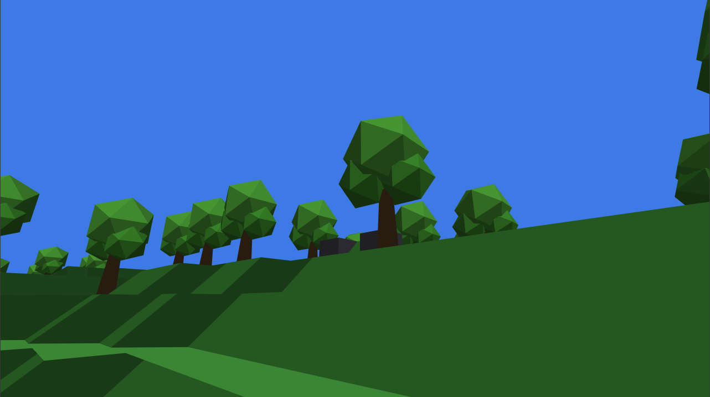](docs/CLIMATES.md#temperate-y-face) | [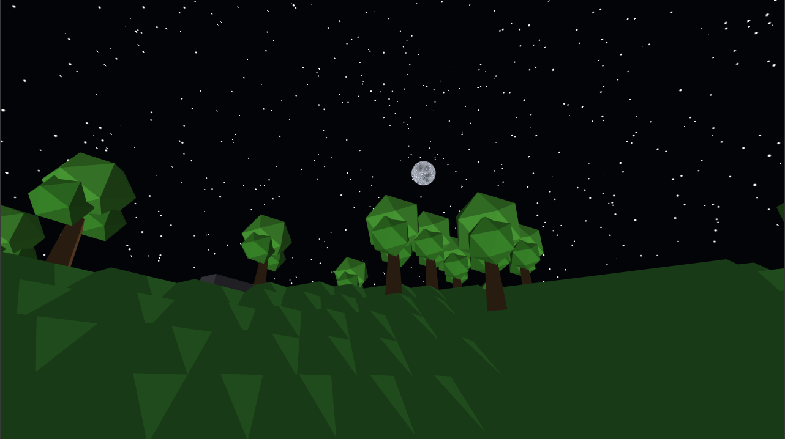](docs/CLIMATES.md#temperate-y-face) |
| **-X** | [Arctic](docs/CLIMATES.md#arctic--x-face) | [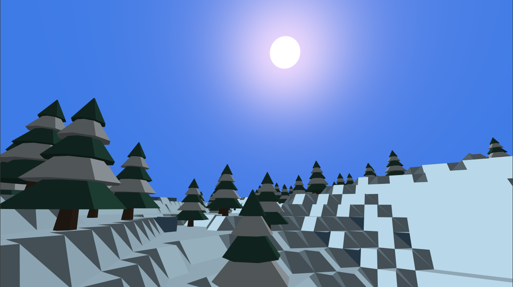](docs/CLIMATES.md#arctic--x-face) | [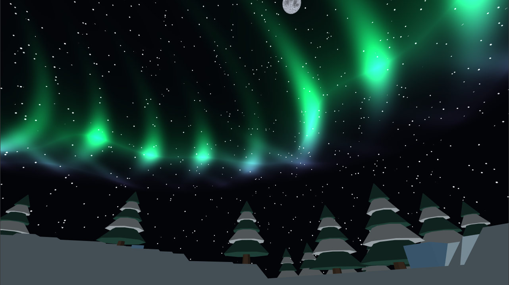](docs/CLIMATES.md#arctic--x-face) |
| **+X** | [Desert](docs/CLIMATES.md#desert-x-face) | [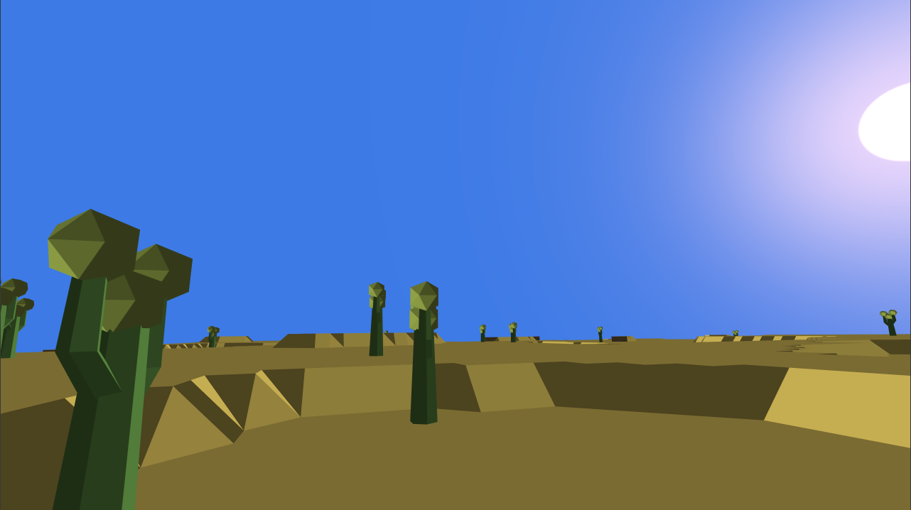](docs/CLIMATES.md#desert-x-face) | [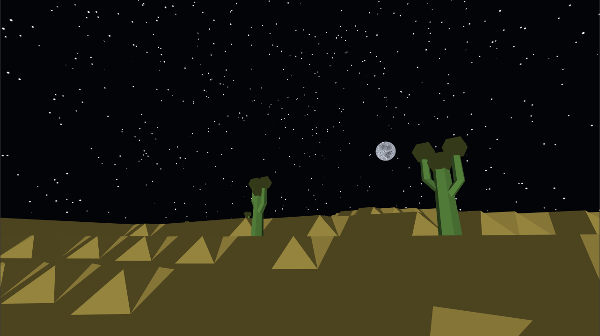](docs/CLIMATES.md#desert-x-face) |
| **+Z** | [Jungle](docs/CLIMATES.md#jungle-z-face) | [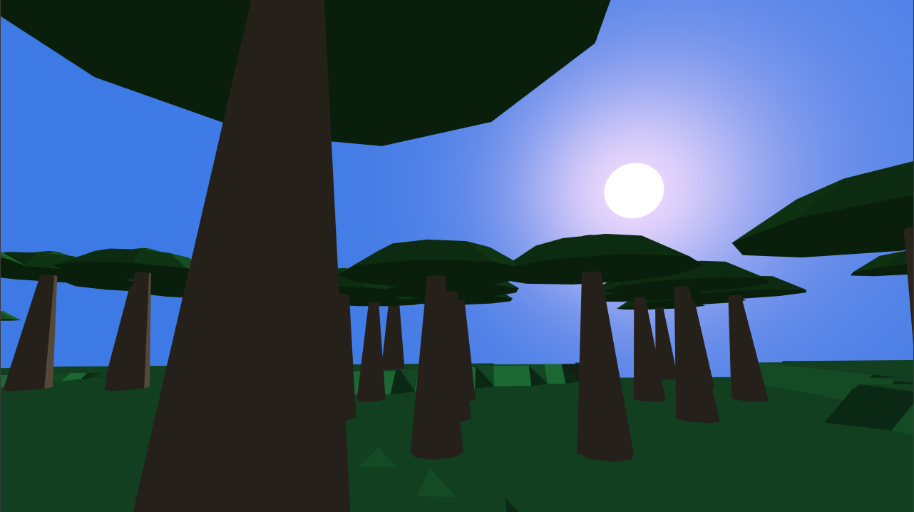](docs/CLIMATES.md#jungle-z-face) | [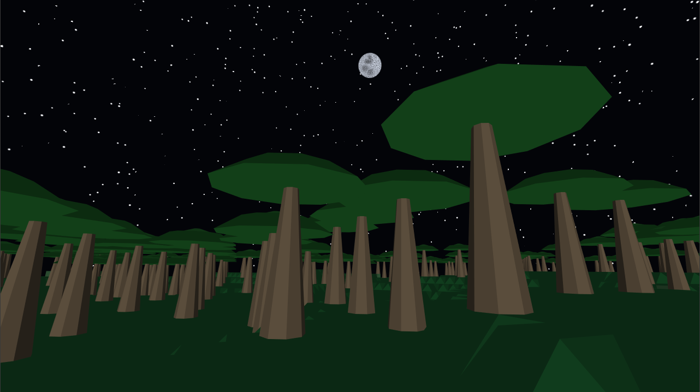](docs/CLIMATES.md#jungle-z-face) |
| **-Z** | [Steppe](docs/CLIMATES.md#steppe--z-face) | [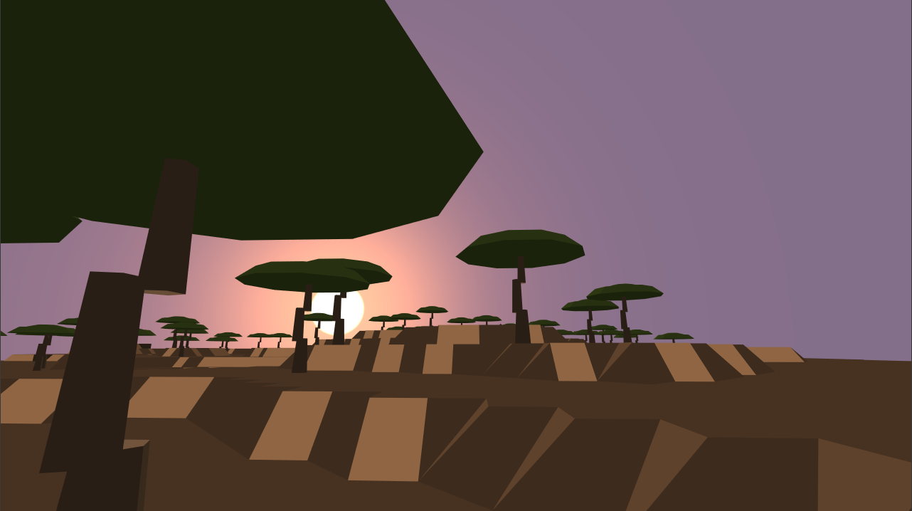](docs/CLIMATES.md#steppe--z-face) | [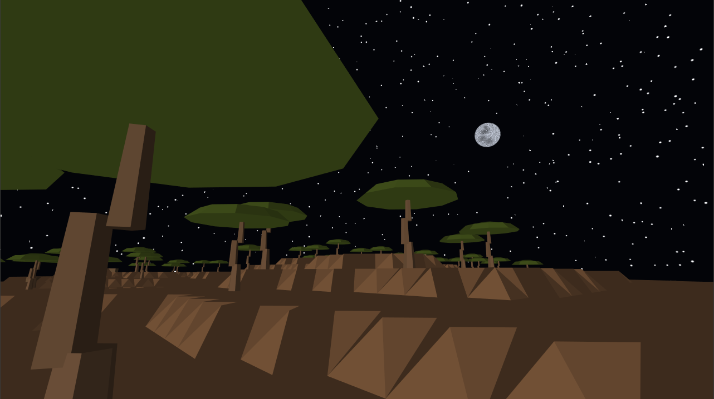](docs/CLIMATES.md#steppe--z-face) |
| **-Y** | [Volcanic](docs/CLIMATES.md#volcanic--y-face) | [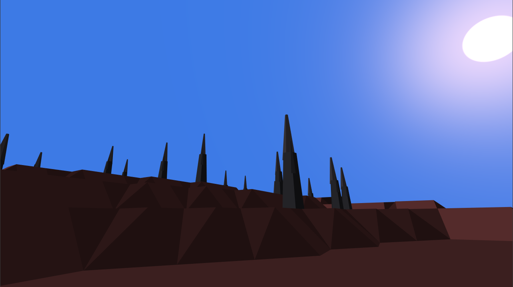](docs/CLIMATES.md#volcanic--y-face) | [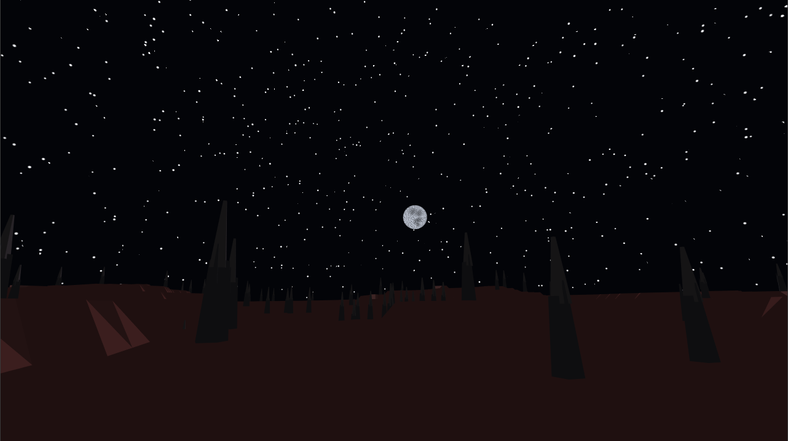](docs/CLIMATES.md#volcanic--y-face) |

*Explore detailed topography, native flora, and hazard profiles in the [Planetary Climate Zones & Biomes](docs/CLIMATES.md) reference.*

### Defy Gravity
Walk right up to the edge of the world and step over. Watch the horizon tilt as gravity seamlessly pivots 90 degrees beneath your feet. Throw arrows, pour water, or drop boulders off the edge and see them curve around the planetary corner into the adjacent gravitational field.

### 3D Character Studio & Dual-Wielding Combat
Press **`Esc`** to open the interactive **Character Studio**, customize your avatar across six medieval archetypes, eight skin complexions, clothing styles, and per-body-part **Size** & **Thickness** sliders on a 360° turntable, and wield weapons in both hands (**Left Click** / **Right Click**):

[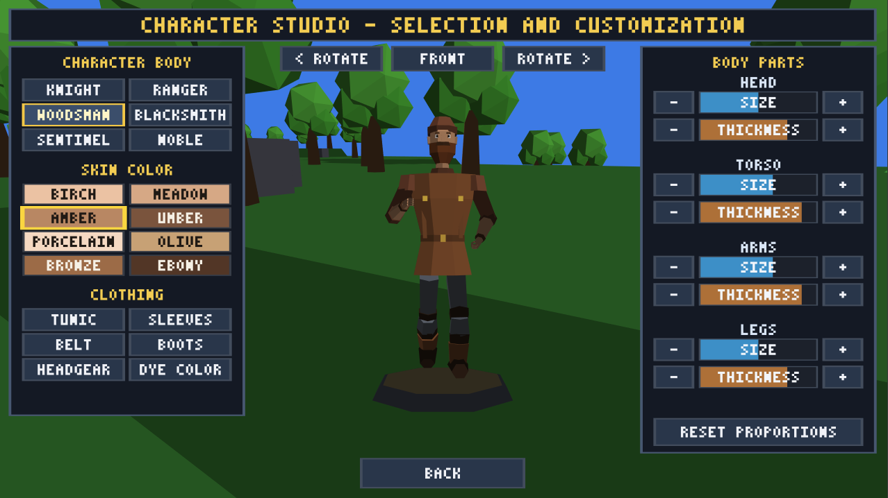](docs/CHARACTER.md)

*See the [Character Concept & Wardrobe Customization Reference](docs/CHARACTER.md) for full details.*

### Dynamic Day/Night Cycle & Celestial Vault
As the golden sun arcs across the celestial vault and slips beneath the horizon, warm atmospheric twilight yields to an expansive cosmic starfield illuminated by the cratered lunar sphere and shimmering polar auroras (*Aurora Borealis*) dancing across the nocturnal Arctic sky. With day length fully configurable (default: 20 minutes, see [Settings](docs/SETTINGS.md)), light touches only parts of the planet at a time while others freeze in nocturnal shadow. When darkness falls, aggressive predators emerge to hunt. If your shelter isn't fortified, your best recourse may be to sprint to the nearest edge and leap into the dawn of a sunlit face.

### Realistic Building & Structural Integrity
Say goodbye to floating islands and gravity-defying dirt towers. Every block in *Low-Cube* relies on structural support. Build load-bearing pillars, sturdy walls, and reinforced roofs—push your architecture too far without a solid foundation, and your fortress will collapse under its own weight.

### Railroads Across the Edges
Tired of walking? Lay down rail networks that snake across mountain ranges and curve directly around 90-degree planetary edges. Hop into a minecart to transport mined diamonds from the depths of a dark face to your foundry on a sunny face in seconds. Build rovers and aerial craft to scout uncharted faces.

### Mysterious Ring Gates
Scattered across the stars are ancient Ring Gates. Step through the shimmering portal into a wormhole tunnel to discover entirely new cubic worlds—some with low gravity where you can leap across canyons, others with crushing gravity and untamed riches.

### Survive, Forge & Defend
- **Manage Your Vitals**: Keep your hunger, thirst, oxygen, and body temperature in balance as you brave freezing peaks, blistering dunes, and airless high altitudes.
- **Master the Forge**: Dig deep toward the indestructible planetary core to unearth copper, iron, gold, and diamonds. Forge stronger weapons, durable tools, and reinforced armor.
- **Secure Your Base**: Place light sources to keep monsters at bay, build secure lockable vaults to safeguard your hard-earned loot, and place a **Life Capsule** to anchor your respawn point.
- **Play Solo or with Friends**: Brave the worlds alone or team up with up to 50 players to build sprawling trans-planetary civilizations.

---

## Quick Play (Pre-built Binaries)

Ready-to-run executables for Linux and Windows are built automatically via GitHub Actions and published under [Releases](../../releases):

- **Linux**: Download `low-cube-linux`, mark as executable, and run:
  ```bash
  chmod +x low-cube-linux
  ./low-cube-linux
  ```
- **Windows**: Download `low-cube-windows.exe` and launch directly by double-clicking.

---

## Development

For environment setup, building, running, and testing instructions, see the [Developer Guide](docs/DEVELOPMENT.md).

---

## Documentation

- [Game Concept](CONCEPT.md)
- [Character Concept & Wardrobe Customization Reference](docs/CHARACTER.md)
- [Planetary Climate Zones & Biomes](docs/CLIMATES.md)
- [Block Catalog & Geometry Reference](docs/BLOCKS.md)
- [Tree Catalog & Forestry Reference](docs/TREES.md)
- [Development Roadmap](docs/ROADMAP.md)
- [Server & Game Settings Guide](docs/SETTINGS.md)
- [Developer Guide](docs/DEVELOPMENT.md)
- [Architecture Decision Records](docs/adr/README.md)

---

## License

This project is open source and licensed under the [MIT License](LICENSE).
