# Block Catalog & Geometry Reference

In **Low-Cube**, the block system is designed according to the principles of **Pure Object-Oriented Programming (OOP)** and **Elegant Objects**:
Geometric shapes ([`FormBlock`](file:///home/mario/code/low-cube/crates/world/src/block/form.rs)) and material properties ([`MaterialBlock`](file:///home/mario/code/low-cube/crates/world/src/block/material/material_block.rs)) are decoupled as **decorators**.

Every geometric shape can be represented in any material. Every block has a unique identifier following the convention:
```text
<material_id>_<shape_id>
```
Examples: `dirt_stair`, `stone_wedge`, `sand_gentle_lower_wedge`, `dark_stone_cube`.

---

## 1. Available Block Shapes (15 Shapes)

| Shape ID | Shape Name | Height / Incline | Climbing Physics (Earth, $g=10$) | Image |
|---|---|---|---|:---:|
| `cube` | **Full Cube** | $1.0\,\text{m}$ (vertical 90°) | Impassable wall; requires a low-G jump or ramps/stairs. | 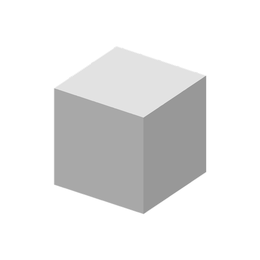 |
| `slab` | **Half Slab** | $0.5\,\text{m}$ (plateau) | Directly scalable (human step height under standard gravity). | 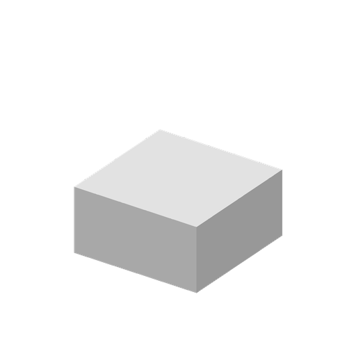 |
| `wedge` | **Ramp Wedge (45°)** | $0.0 \to 1.0\,\text{m}$ (1:1 incline) | Smoothly walkable without jumping impulse. |  |
| `ridge_corner` | **Ridge Corner (45°)** | $0.0 \to 1.0\,\text{m}$ (diagonal ridge) | Convex corner joining two 45° ramps. | 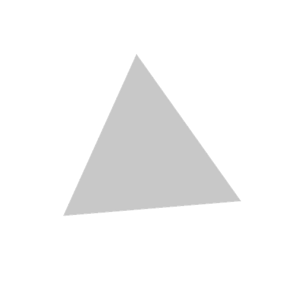 |
| `valley_corner` | **Valley Corner (45°)** | $0.0 \to 1.0\,\text{m}$ (diagonal valley) | Concave inner corner joining two 45° ramps. | 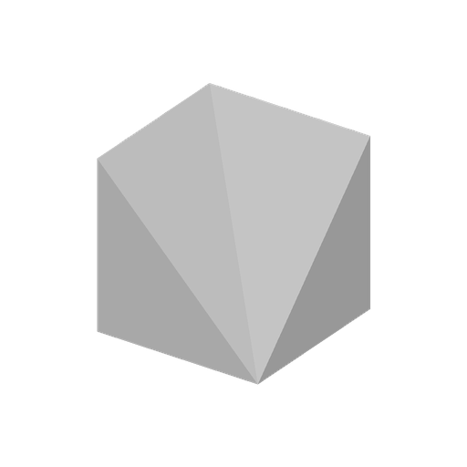 |
| `peak` | **Pyramid Peak** | $0.5\,\text{m}$ (45° peak) | 4-sided pyramid peak as a natural summit point. | 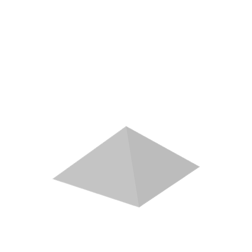 |
| `stair` | **Stair Flight** | $2 \times 0.5\,\text{m}$ steps | Comfortable 2-step climb to full block height. | 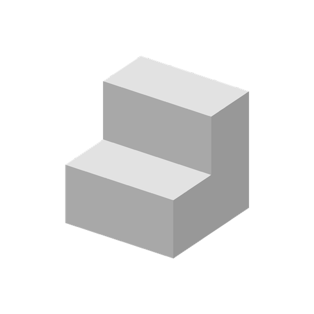 |
| `stair_corner_convex` | **Convex Stair Corner** | $2 \times 0.5\,\text{m}$ steps | 90° exterior corner for stairways. | 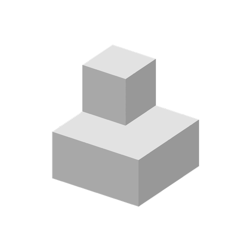 |
| `stair_corner_concave` | **Concave Stair Corner** | $2 \times 0.5\,\text{m}$ steps | 90° interior corner for winding stairways. | 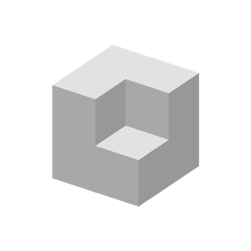 |
| `gentle_lower_wedge` | **Gentle Lower Wedge** | $0.0 \to 0.5\,\text{m}$ (2:1 incline) | Gentle shallow slope leading to first plateau or half slab. |  |
| `gentle_upper_wedge` | **Gentle Upper Wedge** | $0.5 \to 1.0\,\text{m}$ (2:1 incline) | Continuation of the gentle slope to full block height. | 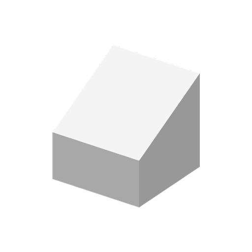 |
| `gentle_lower_ridge` | **Gentle Lower Ridge** | $0.0 \to 0.5\,\text{m}$ (2:1 incline) | Shallow outer corner for gentle terrain ridges. | 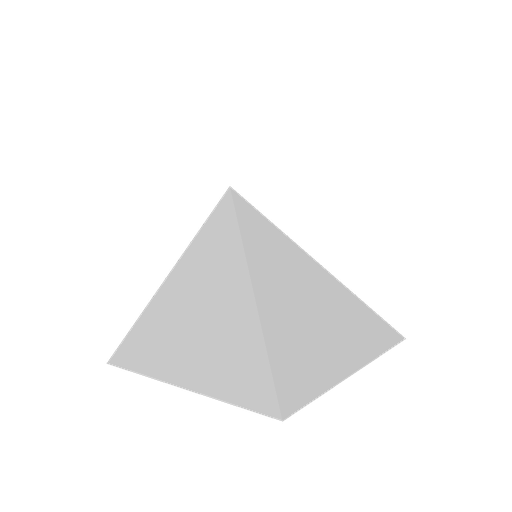 |
| `gentle_upper_ridge` | **Gentle Upper Ridge** | $0.5 \to 1.0\,\text{m}$ (2:1 incline) | Upper outer corner for gentle terrain ridges. | 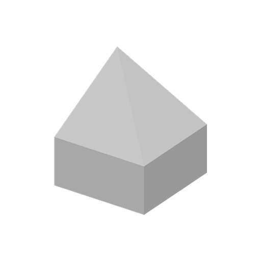 |
| `gentle_lower_valley` | **Gentle Lower Valley** | $0.0 \to 0.5\,\text{m}$ (2:1 incline) | Shallow inner corner for gentle terrain hollows. | 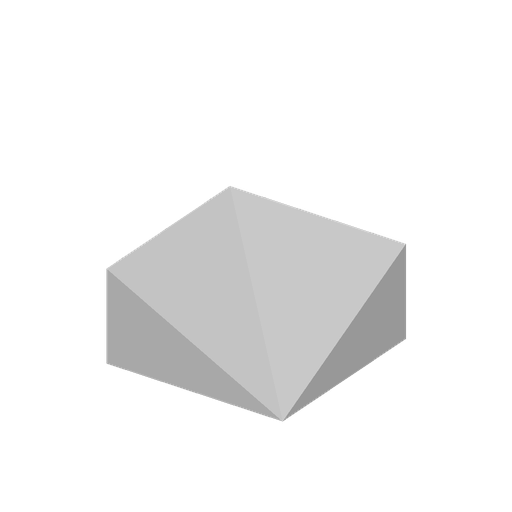 |
| `gentle_upper_valley` | **Gentle Upper Valley** | $0.5 \to 1.0\,\text{m}$ (2:1 incline) | Upper inner corner for gentle terrain hollows. | 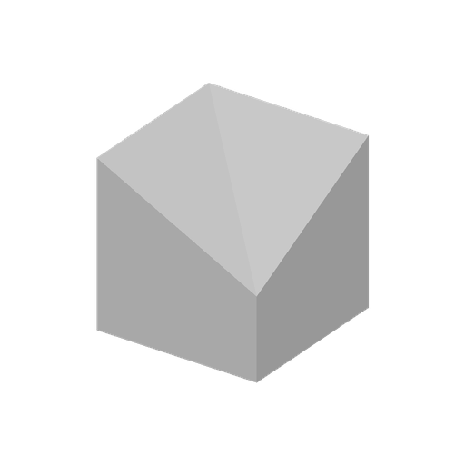 |

---

## 2. Available Materials

| Material ID | Name | RGB Color | Rust Entity | Occurrence / Usage |
|---|---|---|---|---|
| `form` | **Form Block (Template)** | `Vec3(1.0, 1.0, 1.0)` | [`FormBlock`](file:///home/mario/code/low-cube/crates/world/src/block/form.rs) | Neutral building template / geometric prototype. |
| `dirt` | **Dirt (Loam)** | `Vec3(0.48, 0.35, 0.22)` | [`DirtBlock`](file:///home/mario/code/low-cube/crates/world/src/block/material/dirt.rs) | Fertile topsoil, temperate valleys. |
| `sand` | **Sand** | `Vec3(0.85, 0.75, 0.35)` | [`SandBlock`](file:///home/mario/code/low-cube/crates/world/src/block/material/sand.rs) | Warm desert sand, dune landscapes. |
| `snow` | **Snow** | `Vec3(0.92, 0.95, 0.98)` | [`SnowBlock`](file:///home/mario/code/low-cube/crates/world/src/block/material/snow.rs) | Crystalline alpine snow, polar ice caps. |
| `stone` | **Stone (Granite)** | `Vec3(0.48, 0.50, 0.46)` | [`StoneBlock::natural`](file:///home/mario/code/low-cube/crates/world/src/block/material/stone.rs) | Alpine rock, mountain ranges. |
| `dark_stone` | **Dark Stone (Shale)** | `Vec3(0.35, 0.42, 0.35)` | [`StoneBlock::dark`](file:///home/mario/code/low-cube/crates/world/src/block/material/stone.rs) | Dark volcanic rock, crater rims. |
| `lava` | **Lava / Magma** | `Vec3(0.95, 0.28, 0.05)` | [`MaterialBlock`](file:///home/mario/code/low-cube/crates/world/src/block/material/material_block.rs) | Glowing magma pools in calderas. |

---

## 3. Full Block Matrix (Materials $\times$ Shapes)

Each cell shows the rendered image of the corresponding block along with its unique block ID for referencing:

### Basic and Step Blocks

| Shape | Template (`form_*`) | Dirt (`dirt_*`) | Sand (`sand_*`) | Snow (`snow_*`) | Stone (`stone_*`) | Dark Stone (`dark_stone_*`) |
|---|:---:|:---:|:---:|:---:|:---:|:---:|
| **Full Cube** | <br>`form_cube` | 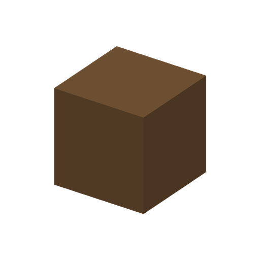<br>`dirt_cube` | 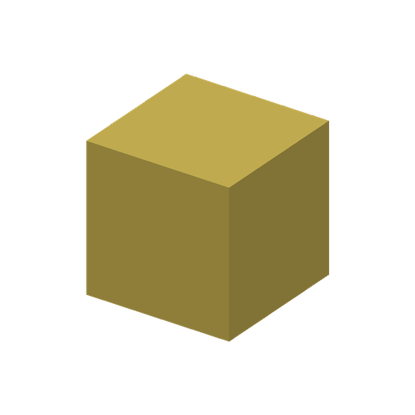<br>`sand_cube` | 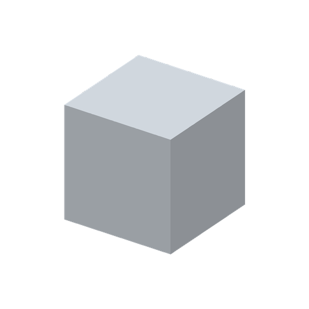<br>`snow_cube` | 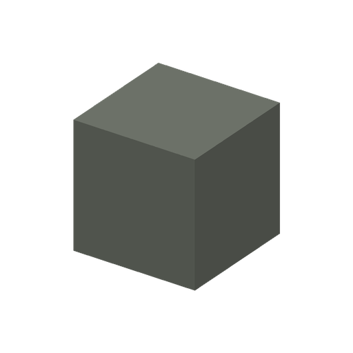<br>`stone_cube` | 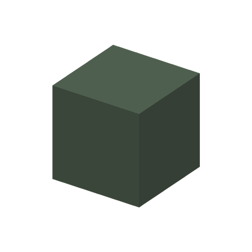<br>`dark_stone_cube` |
| **Half Slab** | <br>`form_slab` | <br>`dirt_slab` | 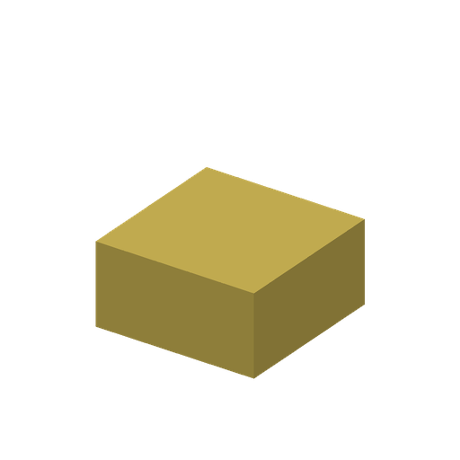<br>`sand_slab` | 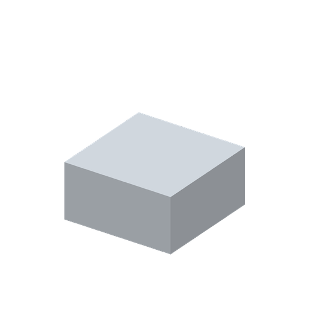<br>`snow_slab` | 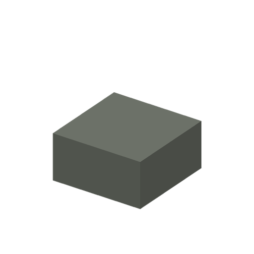<br>`stone_slab` | 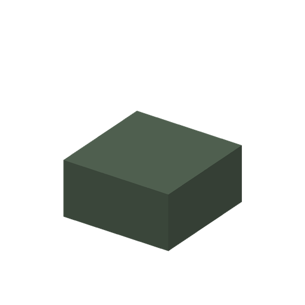<br>`dark_stone_slab` |
| **Stair Flight** | <br>`form_stair` | 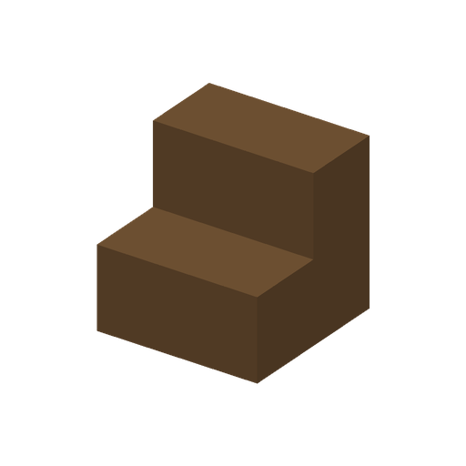<br>`dirt_stair` | <br>`sand_stair` | 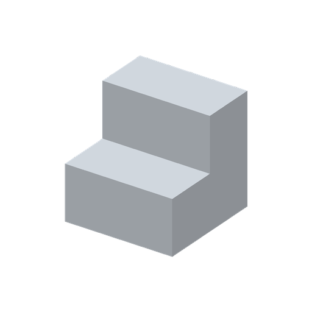<br>`snow_stair` | 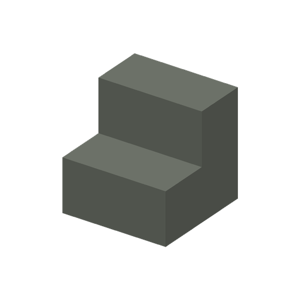<br>`stone_stair` | 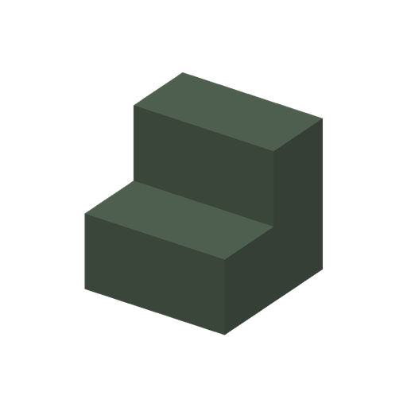<br>`dark_stone_stair` |
| **Convex Stair Corner** | <br>`form_stair_corner_convex` | 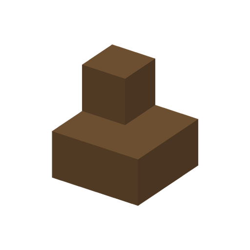<br>`dirt_stair_corner_convex` | 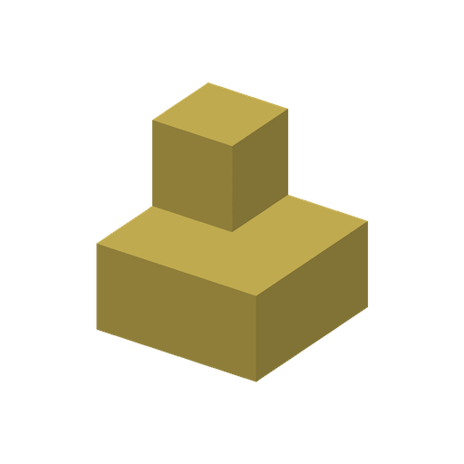<br>`sand_stair_corner_convex` | 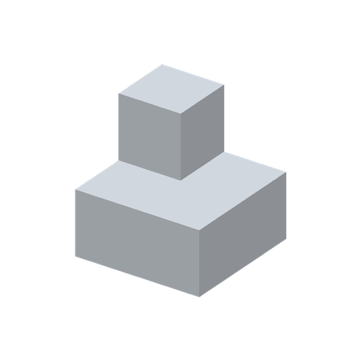<br>`snow_stair_corner_convex` | 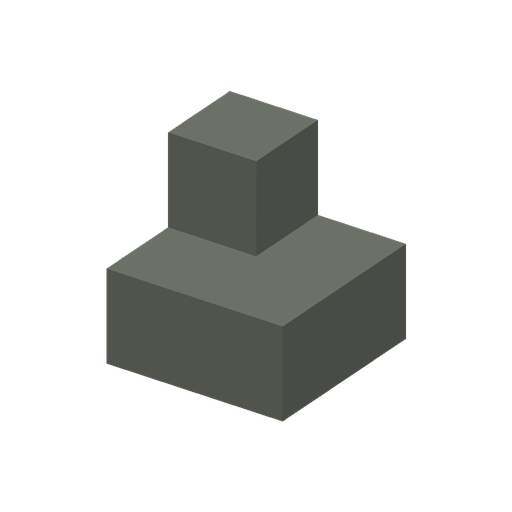<br>`stone_stair_corner_convex` | 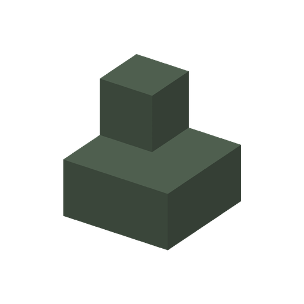<br>`dark_stone_stair_corner_convex` |
| **Concave Stair Corner** | <br>`form_stair_corner_concave` | 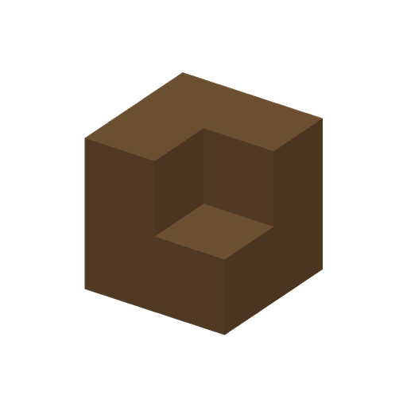<br>`dirt_stair_corner_concave` | <br>`sand_stair_corner_concave` | 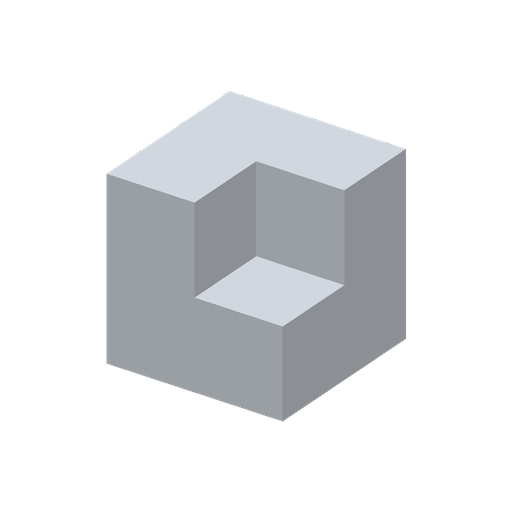<br>`snow_stair_corner_concave` | 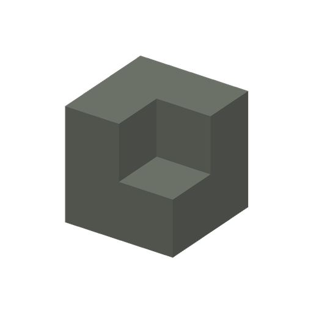<br>`stone_stair_corner_concave` | 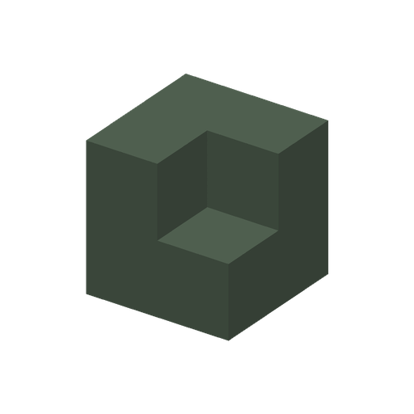<br>`dark_stone_stair_corner_concave` |

---

### Standard Ramps & Corners (45°, 1:1)

| Shape | Template (`form_*`) | Dirt (`dirt_*`) | Sand (`sand_*`) | Snow (`snow_*`) | Stone (`stone_*`) | Dark Stone (`dark_stone_*`) |
|---|:---:|:---:|:---:|:---:|:---:|:---:|
| **Ramp Wedge (45°)** | <br>`form_wedge` | 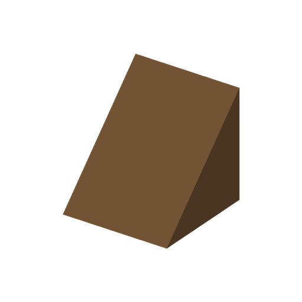<br>`dirt_wedge` | <br>`sand_wedge` | 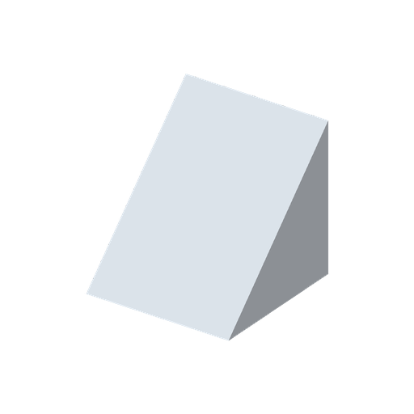<br>`snow_wedge` | <br>`stone_wedge` | 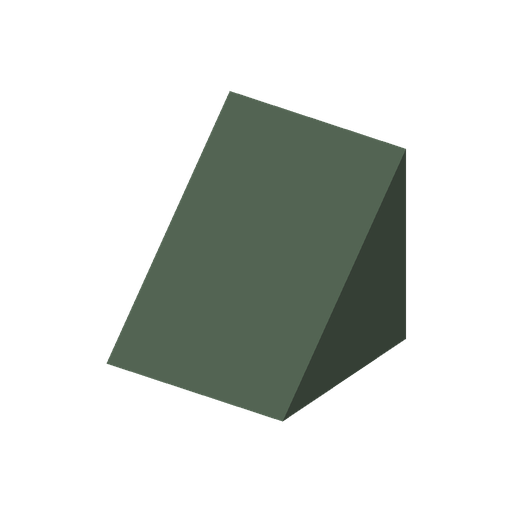<br>`dark_stone_wedge` |
| **Ridge Corner (45°)** | <br>`form_ridge_corner` | <br>`dirt_ridge_corner` | 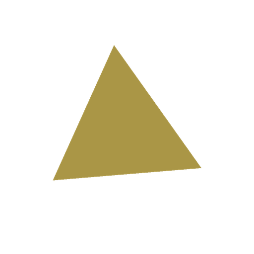<br>`sand_ridge_corner` | 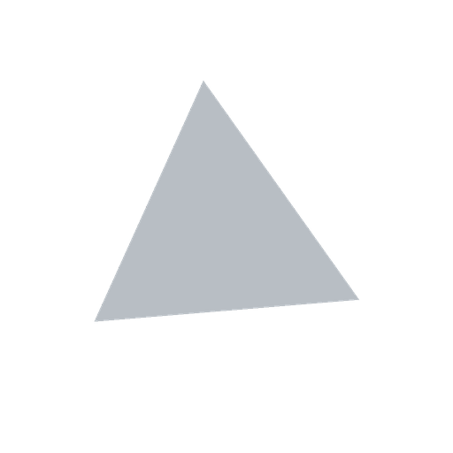<br>`snow_ridge_corner` | 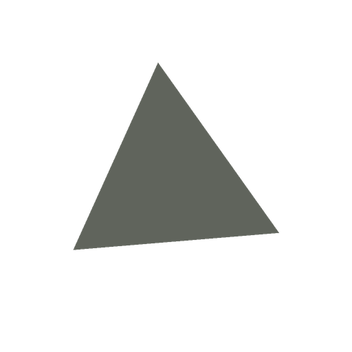<br>`stone_ridge_corner` | <br>`dark_stone_ridge_corner` |
| **Valley Corner (45°)** | <br>`form_valley_corner` | 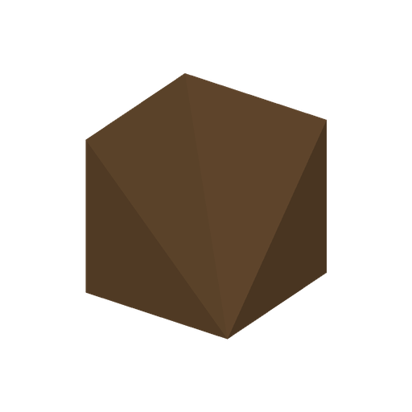<br>`dirt_valley_corner` | 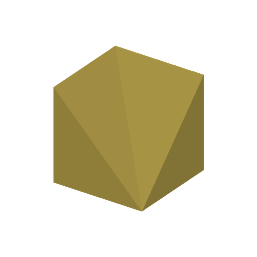<br>`sand_valley_corner` | 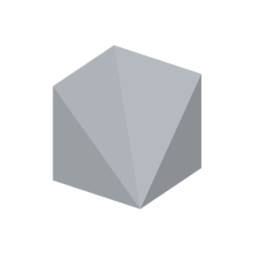<br>`snow_valley_corner` | 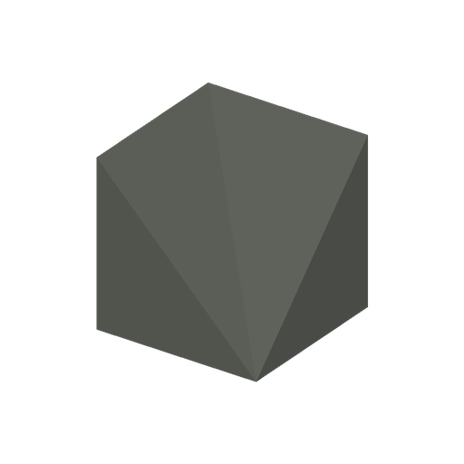<br>`stone_valley_corner` | 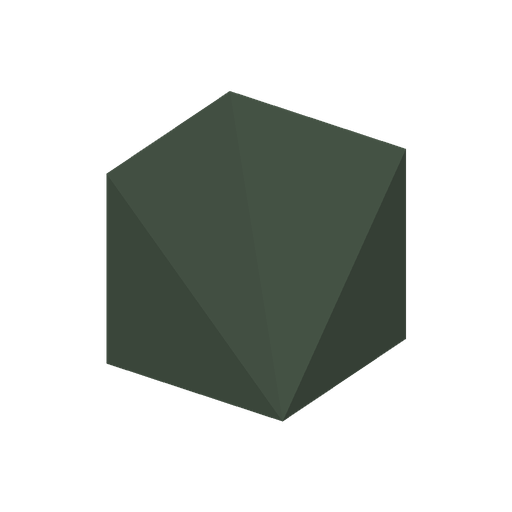<br>`dark_stone_valley_corner` |
| **Pyramid Peak** | <br>`form_peak` | 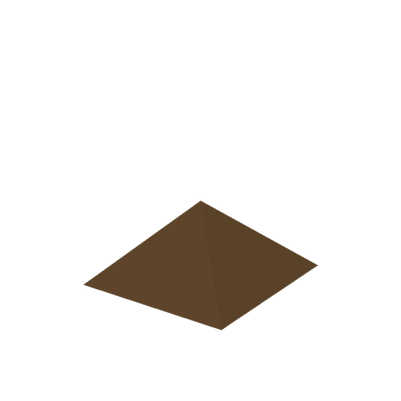<br>`dirt_peak` | 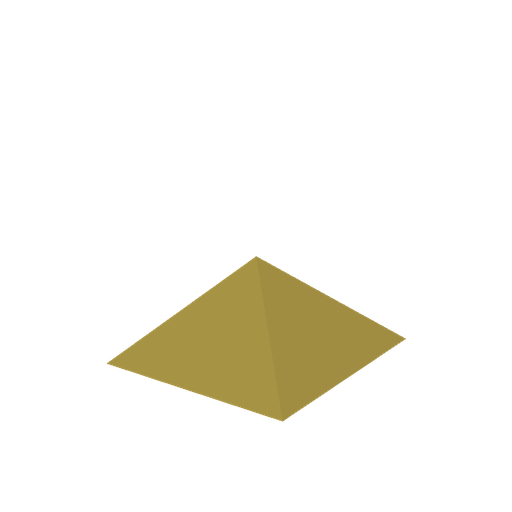<br>`sand_peak` | <br>`snow_peak` | <br>`stone_peak` | <br>`dark_stone_peak` |

---

### Gentle Ramps & Corners (2:1 Incline)

| Shape | Template (`form_*`) | Dirt (`dirt_*`) | Sand (`sand_*`) | Snow (`snow_*`) | Stone (`stone_*`) | Dark Stone (`dark_stone_*`) |
|---|:---:|:---:|:---:|:---:|:---:|:---:|
| **Gentle Lower Wedge** | <br>`form_gentle_lower_wedge` | <br>`dirt_gentle_lower_wedge` | <br>`sand_gentle_lower_wedge` | <br>`snow_gentle_lower_wedge` | <br>`stone_gentle_lower_wedge` | <br>`dark_stone_gentle_lower_wedge` |
| **Gentle Upper Wedge** | <br>`form_gentle_upper_wedge` | <br>`dirt_gentle_upper_wedge` | <br>`sand_gentle_upper_wedge` | <br>`snow_gentle_upper_wedge` | <br>`stone_gentle_upper_wedge` | <br>`dark_stone_gentle_upper_wedge` |
| **Gentle Lower Ridge** | <br>`form_gentle_lower_ridge` | <br>`dirt_gentle_lower_ridge` | <br>`sand_gentle_lower_ridge` | <br>`snow_gentle_lower_ridge` | <br>`stone_gentle_lower_ridge` | <br>`dark_stone_gentle_lower_ridge` |
| **Gentle Upper Ridge** | <br>`form_gentle_upper_ridge` | <br>`dirt_gentle_upper_ridge` | <br>`sand_gentle_upper_ridge` | <br>`snow_gentle_upper_ridge` | <br>`stone_gentle_upper_ridge` | <br>`dark_stone_gentle_upper_ridge` |
| **Gentle Lower Valley** | <br>`form_gentle_lower_valley` | <br>`dirt_gentle_lower_valley` | <br>`sand_gentle_lower_valley` | <br>`snow_gentle_lower_valley` | <br>`stone_gentle_lower_valley` | <br>`dark_stone_gentle_lower_valley` |
| **Gentle Upper Valley** | <br>`form_gentle_upper_valley` | <br>`dirt_gentle_upper_valley` | <br>`sand_gentle_upper_valley` | <br>`snow_gentle_upper_valley` | <br>`stone_gentle_upper_valley` | <br>`dark_stone_gentle_upper_valley` |

---

## 4. Block Catalog & Snapshot CLI (`scripts/block_catalog.py`)

To inspect and list blocks or to render new documentation images after code changes, the CLI tool [`scripts/block_catalog.py`](file:///home/mario/code/low-cube/scripts/block_catalog.py) is available:

### Commands

- **List all available blocks**:
  ```bash
  ./scripts/block_catalog.py list
  ```
- **List all block shapes**:
  ```bash
  ./scripts/block_catalog.py list --forms
  ```
- **List all materials**:
  ```bash
  ./scripts/block_catalog.py list --materials
  ```
- **Render a snapshot of a specific block**:
  ```bash
  ./scripts/block_catalog.py render dirt_stair my_stair.png
  ```
- **Regenerate all 105 block images**:
  ```bash
  ./scripts/block_catalog.py render-all docs/images/blocks/
  ```
