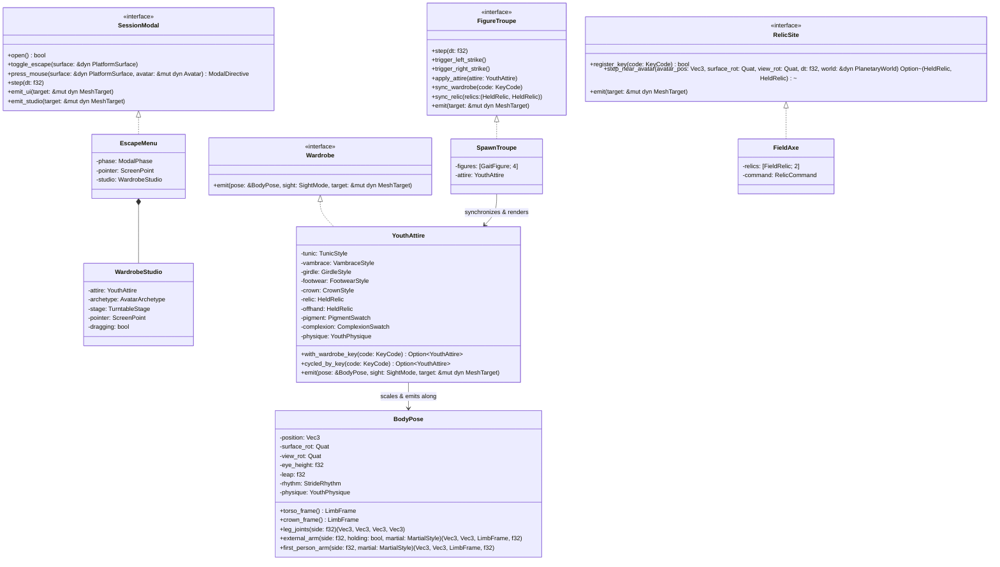

# Character Concept & Wardrobe Customization Reference

In **Low-Cube**, the player avatar is embodied as a **faceted low-poly medieval youth / squire** (~15–18 years old). Designed to harmonize with the non-textured, flat-shaded polyhedral world and trees, the character combines **First-Person Body Awareness** (visible hands, forearms, torso, belt, chausses, and boots when looking down) with a complete **Multiplayer & Looking-Glass Mirror** appearance (adding neck, head, hair, or medieval headgear).

---

## 1. Visual Concept & Perspectives

| Medieval Youth Archetypes (3rd-Person / Mirror) | First-Person Body & Articulated Hands |
| :---: | :---: |
|  |  |
| *Faceted medieval tunic, belt, chausses, cuffed boots, and headgear.* | *Looking down in First-Person reveals the flat-front doublet, belt, legs, and 5-finger hands.* |

### Dual-Perspective Sight Modes ([`SightMode`](../crates/client/src/attire/sight.rs))

1. **First-Person Sight (`SightMode::FirstPersonSight`)**:
   - The camera sits at the avatar's eye origin (`eye_height = 0.80 m` above the torso center, `1.78 m` above the ground when standing; `1.38 m` when sneaking) and pulls slightly forward (`0.09–0.16 m`) when looking down so the upper chest never occludes the feet.
   - **Centered HUD Crosshair (`ScreenPoint::emit_crosshair`)**: During active gameplay, a high-contrast 5-element framed reticle crosshair is rendered at screen center (`(0.0, 0.0)` NDC), marking the exact focal convergence point for both right-hand and left-hand weapon strikes.
   - **Demand-Driven Hand Raising**: When a hand is empty (`HeldRelic::EmptyPalm`), the arm hangs naturally at the side of the body (`BodyPose::external_arm`) so empty hands never clutter the forward view. When holding an item in the right or left hand, that hand is raised into the First-Person field of view (`BodyPose::first_person_arm`).
   - **Full Downward Gaze Awareness**: Tilting the view downward reveals the 3D V-taper medieval doublet/jerkin, waist girdle, chausses (hose), knees, muscular calves, and boots stepping or jumping across the terrain. The head and hair (`CrownStyle`) are omitted in First-Person so they never obstruct the camera frustum.
2. **Looking-Glass Mirror & Multiplayer Sight (`SightMode::LookingGlassSight`)**:
   - Pressing **`M`** toggles the **Looking-Glass Mirror**, shifting the camera `1.65 m` in front of the avatar looking back at the character.
   - Emits the complete multiplayer peer mesh including the neck, 3-tier sculpted youthful head (jaw/chin, cheek/face, rounded cranium vault), ears, nose bridge, eyes, and selected hairstyle or medieval headgear ([`CrownStyle`](../crates/client/src/attire/crown.rs), [`PolygonHeadgear`](../crates/client/src/attire/headgear.rs)) fully covering the back of the head.
3. **Spawn Showcase Troupe ([`SpawnTroupe`](../crates/client/src/troupe.rs), [`GaitFigure`](../crates/client/src/troupe.rs), [`TroupeAvatar`](../crates/client/src/troupe.rs))**:
   - Four animated character instances are stationed `2.8 m` in front of the spawn point facing the player (`x = -1.35 m, -0.45 m, +0.45 m, +1.35 m`), continuously showcasing **Standing**, **Walking**, **Running**, and **Jumping** gaits with zero runtime heap allocations.
   - All four figures synchronize live with the player's wardrobe customization, dual-hand held relics, and independent left/right mouse-button strikes.

---

## 2. Escape Menu & 3D Character Studio

Pressing **`Escape`** during gameplay releases the mouse cursor and opens the modal pause overlay ([`EscapeMenu`](../crates/client/src/menu/mod.rs), [`SessionModal`](../crates/client/src/menu/mod.rs)) with **`RESUME GAME`**, **`CHARACTER`**, and **`QUIT GAME`** buttons. Selecting **`CHARACTER`** launches the interactive **3D Character Studio** ([`WardrobeStudio`](../crates/client/src/menu/studio.rs)):


### Studio Layout & Interactive Controls
- **360° Turntable Stage ([`TurntableStage`](../crates/client/src/menu/stage.rs), [`StudioAnimation`](../crates/client/src/menu/stage.rs))**:
  - Displays a full-height 3D character on an octagonal stone pedestal in the center of the screen.
  - Rotate the character freely by dragging with the mouse on the center stage, clicking **`< ROTATE`** / **`FRONT`** / **`ROTATE >`**, or pressing **`A` / `D`** or **`Left` / `Right`** arrow keys.
  - The center figure automatically cycles every `2.2 s` through all 7 character animations:
    1. `StandingIdle`
    2. `WalkingStride`
    3. `RunningSprint`
    4. `CrouchingSneak`
    5. `JumpingLeap`
    6. `AxeCleave`
    7. `SwordSlash`
- **Left Panel — Character Body, Skin Color & Clothing**:
  - **Character Body Archetypes ([`AvatarArchetype`](../crates/client/src/menu/archetype.rs))**: 6 distinct medieval archetypes (`KNIGHT`, `RANGER`, `WOODSMAN`, `BLACKSMITH`, `SENTINEL`, `NOBLE`), each configuring unique 3D armor/garments, headgear, back gear, and anatomy proportions.
  - **Skin Color ([`ComplexionSwatch`](../crates/client/src/attire/palette.rs))**: 8 selectable skin tones (`BIRCH`, `MEADOW`, `AMBER`, `UMBER`, `PORCELAIN`, `OLIVE`, `BRONZE`, `EBONY`).
  - **Clothing**: Interactive buttons to cycle `TUNIC`, `SLEEVES`, `BELT`, `BOOTS`, `HEADGEAR`, and `DYE COLOR`.
- **Right Panel — Body Parts (`SIZE` & `THICKNESS`)**:
  - Independent `-` / `+` controls and live progress gauges ([`BodyRegion`](../crates/client/src/attire/proportion.rs), [`PartProportion`](../crates/client/src/attire/proportion.rs), [`YouthPhysique`](../crates/client/src/attire/proportion.rs)) for **`HEAD`**, **`TORSO`**, **`ARMS`**, and **`LEGS`**, plus **`RESET PROPORTIONS`** to restore balanced defaults.

---

## 3. Wardrobe Hotkeys, Dual-Wielding & Interactive Weapons

Players can also customize their character live during gameplay using keyboard hotkeys or pick up medieval weapons resting on the ground near spawn. Every wardrobe change is immediately persisted to `character.toml` via [`FileAttire`](../crates/client/src/attire/file_attire.rs) and encoded into a compact 9-byte array (`[u8; 9]`) for multiplayer synchronization.

| Hotkey / Input | Category | Domain Object | Available Styles / Actions |
| :---: | :--- | :--- | :--- |
| **`Esc`** | **Pause & Character Studio** | [`EscapeMenu`](../crates/client/src/menu/mod.rs)<br>[`WardrobeStudio`](../crates/client/src/menu/studio.rs) | Opens the pause menu (`RESUME GAME`, `CHARACTER`, `QUIT GAME`) and the 3D Character Studio. |
| **`1`** | **Upper Garment** | [`TunicStyle`](../crates/client/src/attire/garments.rs)<br>[`PolygonAccoutrement`](../crates/client/src/attire/accoutrement.rs) | • `0`: **Linen Doublet** • `1`: **Quilted Jerkin** • `2`: **Peasant Shirt**<br>• `3`: **Plate Cuirass** • `4`: **Forge Apron** • `5`: **Heraldic Tabard** |
| **`2`** | **Forearms & Bracers** | [`VambraceStyle`](../crates/client/src/attire/hands.rs) | • `0`: **Bare Forearms** • `1`: **Rawhide Wraps** • `2`: **Studded Vambraces**<br>• `3`: **Plate Gauntlets** • `4`: **Forge Gloves** • `5`: **Puffed Sleeves** |
| **`3`** | **Waist Girdle & Back Gear** | [`GirdleStyle`](../crates/client/src/attire/garments.rs)<br>[`PolygonAccoutrement`](../crates/client/src/attire/accoutrement.rs) | • `0`: **Knotted Cord** • `1`: **Pouched Girdle** *(+ Back Quiver)* • `2`: **Unbelted Waist** *(+ Timber Backpack)*<br>• `3`: **Knightly Belt** • `4`: **Forge Belt** • `5`: **Garrison Belt** |
| **`4`** | **Chausses & Footwear** | [`FootwearStyle`](../crates/client/src/attire/footwear.rs) | • `0`: **Cuffed Boots** • `1`: **Laced Boots** • `2`: **Turnshoes**<br>• `3`: **Plate Greaves** • `4`: **Forge Boots** • `5`: **Garrison Boots** |
| **`5`** | **Hair & Headgear** | [`CrownStyle`](../crates/client/src/attire/crown.rs)<br>[`PolygonHeadgear`](../crates/client/src/attire/headgear.rs) | • `0`: **Tousled Mop** • `1`: **Squire Crop** • `2`: **Medieval Gugel** • `3`: **Merchant Cap**<br>• `4`: **Visored Helm** • `5`: **Kettle Helm** • `6`: **Smith Goggles** *(+ Beard)* |
| **`6`** | **Natural Cloth Dye** | [`PigmentSwatch`](../crates/client/src/attire/palette.rs) | • `0`: **Unbleached Linen** • `1`: **Forest Moss** • `2`: **Madder Crimson** • `3`: **Woad Indigo** • `4`: **Ochre Gold** • `5`: **Saddle Hide** • `6`: **Charcoal Slate** • `7`: **Russet Bark** |
| **`7`** | **Complexion & Stature** | [`ComplexionSwatch`](../crates/client/src/attire/palette.rs)<br>[`YouthPhysique`](../crates/client/src/attire/proportion.rs) | **8 Skin Tones**: Birch, Meadow, Amber, Umber, Porcelain, Olive, Bronze, Ebony<br>**Per-Region Proportions**: Head, Torso, Arms, and Legs (`SIZE` & `THICKNESS`) |
| **`8` / `H`** | **Right-Hand Relic** | [`HeldRelic`](../crates/client/src/attire/relic.rs) | • `0`: **Empty Palm** • `1`: **Quarried Stone** • `2`: **Timber Torch**<br>• `3`: **Wooden Mallet** • `4`: **Woodman Axe** • `5`: **Knightly Sword** |
| **`9` / `G`** | **Left-Hand Relic** | [`HeldRelic`](../crates/client/src/attire/relic.rs) | Independent cycling of all 6 [`HeldRelic`](../crates/client/src/attire/relic.rs) items in the left hand (`offhand`) for full dual-wielding. |
| **`E`** | **Pick Up Weapon** | [`FieldAxe`](../crates/client/src/axe.rs) | Picks up the medieval **Woodman Axe** or **Knightly Sword** near spawn into the next free hand (right hand first, then left hand). |
| **`Q`** | **Throw Weapon** | [`FieldAxe`](../crates/client/src/axe.rs) | Throws a wielded weapon forward on a ballistic arc with planetary gravity and spin until it lands back on the terrain. |
| **Left Click** | **Left-Hand Strike** | [`Avatar::trigger_left_strike`](../crates/client/src/avatar.rs) | Strikes with the weapon/tool held in the **left hand** (`offhand`), converging onto the center crosshair. |
| **Right Click** | **Right-Hand Strike** | [`Avatar::trigger_right_strike`](../crates/client/src/avatar.rs) | Strikes with the weapon/tool held in the **right hand** (`relic`), converging onto the center crosshair. |
| **`M`** | **Looking-Glass Mirror** | [`SightMode`](../crates/client/src/attire/sight.rs) | Toggles between First-Person view (`FirstPersonSight`) and frontal 3rd-Person mirror inspection (`LookingGlassSight`). |

---

## 4. Biomechanics, Proportions & Martial Kinematics

### 4.1 Seamless Wrist, Tapered Hand & Dual-Hand Grip ([`VambraceStyle::emit`](../crates/client/src/attire/hands.rs))
- **Decoupled Forearm & Hand Frames**: The forearm and bracer (`forearm_frame`) align strictly along the bone vector from `elbow_world` to `wrist_world`, while the hand (`arm_frame`) pivots naturally at the wrist joint (`-0.020..0.004 m`) and flows seamlessly into the palm (`0.0..0.064 m`) without gaps.
- **Downward Wrist Hinge (`wrist_snap`)**: During an axe or sword strike, the hand hinges downward at the wrist (`LimbFrame::pitched(wrist_snap)`) so the weapon tilts forward for extended reach toward trees or opponents.
- **Tapered Palm, Thumb & Fingers**: The palm narrows from wrist (`0.022 m`) to knuckles (`0.010 m`), the thumb (`~4 cm`) tapers from `0.0110 m` to `0.0042 m`, and the 4 fingers taper across two phalanges from `0.0094 m` through `0.0066 m` to slender fingertips (`0.0036 m`).
- **Gait-Responsive Finger Flexion ([`BodyPose::finger_curl`](../crates/client/src/attire/pose.rs))**:
  - **Standing (`0.18`) & Walking (`0.25`)**: Hands stay low and relaxed with open fingers.
  - **Sprinting (`0.96`)**: Elbows stay low (`>= 0.20 m` below shoulders) while abducting slightly outward laterally, and all 5 fingers clench into an athletic running fist.
  - **Holding a Relic (`0.88`)**: Left and/or right hand fingers wrap firmly around the grip pocket (`gx = -side * 0.025 m`, `gz = 0.054 m`).

### 4.2 Weapon-Specific Martial Animations ([`MartialStyle`](../crates/client/src/attire/relic.rs), [`BodyPose::external_arm`](../crates/client/src/attire/pose.rs), [`BodyPose::first_person_arm`](../crates/client/src/attire/pose.rs))
- **Medieval Woodman's Axe (`HeldRelic::WoodmanAxe` -> `MartialStyle::LumberjackCleave`)**:
  - Modeled after a historical medieval bearded felling axe with a curved ash-wood helve (`38 cm`), forged iron socket with poll, downward-hooked beard, and convex honed steel cutting edge.
  - **Overhead Semicircular Swing & Outward Hand Roll**: Striking lifts the forearm high upward during wind-up (`wind`) and swings it with momentum in a smooth semicircular arc (`bow` -> `strike`) downward while rotating the hand and axe head laterally outward (`roll_y`), bringing the cutting edge directly onto the center HUD crosshair at full strike (`c = 0.68`).
- **Medieval Knightly Sword (`HeldRelic::KnightlySword` -> `MartialStyle::SwordplaySlash`)**:
  - Modeled with an octagonal iron wheel pommel, leather-bound grip, cruciform crossguard, and a double-edged steel blade (`68 cm`) with a central fuller tapering to an acute point.
  - **Tucked-Elbow Forward Slash to Crosshair**: Striking keeps the elbow tucked inward (`elbow_x` never flares outward) while driving the forearm forward and snapping the wrist downward (`wrist_snap = 1.32 rad`) so the sword tip tilts far forward and touches the exact center of the HUD crosshair (`< 5 mm` deviation) at full strike.

### 4.3 Two-Legged Jumping Kinematics & V-Taper Torso ([`BodyPose::leg_joints`](../crates/client/src/attire/pose.rs), [`AvatarPosture::advance_leap`](../crates/client/src/posture.rs))
- **Four-Phase Athletic Jump Cycle**: Both for the player (`AvatarPosture::advance_leap`), the 4th spawn showcase character (`GaitFigure::jumping_at`), and the Character Studio (`StudioAnimation::JumpingLeap`), jumping executes a smooth $C^1$-continuous 4-phase sequence:
  1. **Takeoff Knee Bend**: Both hips and knees flex deeply (`> 70°` knee bend, lowering the pelvis while keeping the torso at full anatomical height and feet planted on the ground).
  2. **Airborne Extension**: Both legs extend straight and slightly backward (`theta_hip < 0`, `theta_knee -> 0`) with plantarflexed toes while leaping upward/forward and smoothly swinging the arms.
  3. **Landing Cushion**: Touchdown compresses both knees deeply again to absorb impact.
  4. **Upright Recovery**: Smoothly straightens back to the standing posture while keeping the neck and head (`BodyPose::crown_frame`) welded to the shoulders at all times.

### 4.4 Physical Body Envelope ([`BodyEnvelope`](../crates/client/src/envelope.rs))
- Wraps the planetary surface constraint with an 8-point horizontal octagon (`radius = 0.30 m`) around the avatar's waist and chest (`+0.35 m` above feet).
- Prevents the First-Person camera and upper torso from clipping into `1×1×1` solid walls or tree trunks while preserving smooth lateral wall-sliding.

---

## 5. Profile Persistence (`character.toml`) & Multiplayer Codec

Whenever a wardrobe key (`1`–`9`, `G`, or `H`) is pressed, [`FileAttire`](../crates/client/src/attire/file_attire.rs) saves the configuration to `character.toml` in the working directory:

```toml
# Medieval Youth Avatar Profile
[character]
tunic = 0
vambrace = 1
girdle = 0
footwear = 0
crown = 0
relic = 0
pigment = 0
complexion = 0
physique = 0
```

Both the right-hand `relic` (`0..=5`) and left-hand `offhand` (`0..=5`) are packed into the `relic` byte as `relic.code() + offhand.code() * 6` (`0..36`). For network transmission between multiplayer peers, [`AttireProfile::encode_multiplayer`](../crates/client/src/attire/file_attire.rs) serializes the entire appearance into a deterministic 9-byte packet (`[u8; 9]`), which peers decode into an immutable [`YouthAttire`](../crates/client/src/attire/mod.rs) value object and render via `SightMode::LookingGlassSight`.

---

## 6. Architectural Design (Pure OOP & Elegant Objects)

In compliance with [AGENTS.md](../AGENTS.md), all character, studio, troupe, and relic site entities are immutable or encapsulated domain objects that communicate via trait interfaces (`Wardrobe`, `AttireProfile`, `FacetedSolid`, `FigureTroupe`, `RelicSite`, `SessionModal`) without getters, setters, or procedural utility classes:


