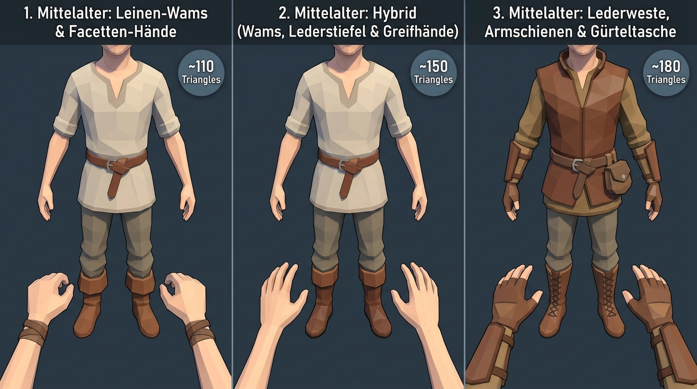
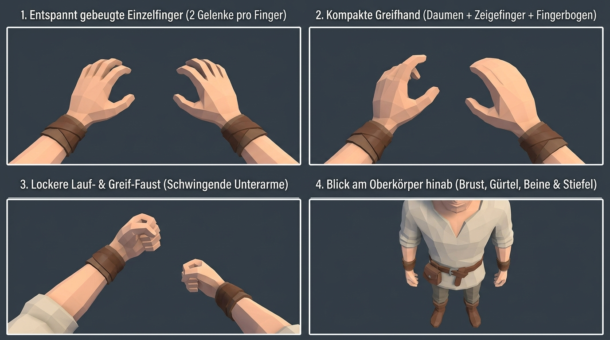
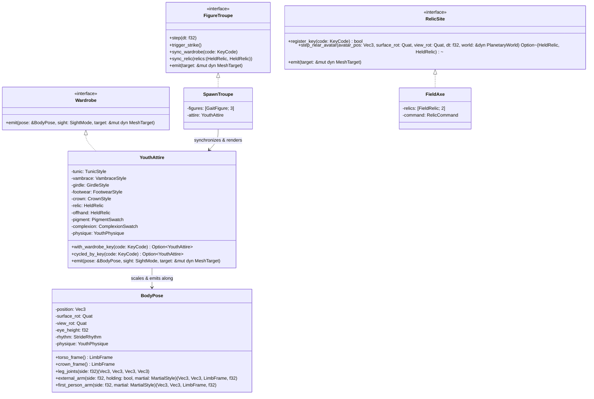

# Character Concept & Wardrobe Customization Reference

In **Low-Cube**, the player avatar is embodied as a **faceted low-poly medieval youth / squire** (*Junger Knappe / Lehrling*, ~15–18 years old). Designed to harmonize with the non-textured, flat-shaded polyhedral world and trees, the character combines **First-Person Body Awareness** (visible hands, forearms, torso, belt, chausses, and boots when looking down) with a complete **Multiplayer & Looking-Glass Mirror** appearance (adding neck, head, hair, or medieval hood).

---

## 1. Visual Concept & Perspectives

| Medieval Youth Archetypes (3rd-Person / Mirror) | First-Person Body & Articulated Hands |
| :---: | :---: |
|  |  |
| *Faceted medieval tunic, belt, chausses, cuffed boots, and headgear.* | *Looking down in First-Person reveals the flat-front doublet, belt, legs, and 5-finger hands.* |

### Dual-Perspective Sight Modes ([`SightMode`](../crates/client/src/attire/sight.rs))

1. **First-Person Sight (`SightMode::FirstPersonSight`)**:
   - The camera sits at the avatar's eye origin (`eye_height = 0.80 m` above the torso center, `1.78 m` above the ground when standing; `1.38 m` when sneaking) and pulls slightly forward (`0.09–0.16 m`) when looking down so the upper chest never occludes the feet.
   - **Demand-Driven Hand Raising**: When a hand is empty (`HeldRelic::EmptyPalm`), the arm hangs naturally at the side of the body (`BodyPose::external_arm`) so empty hands never clutter the forward view. When holding an item in the right or left hand, that hand is raised into the First-Person field of view (`BodyPose::first_person_arm`).
   - **Full Downward Gaze Awareness**: Tilting the view downward reveals the 3D V-taper medieval doublet/jerkin, waist girdle, chausses (hose), knees, muscular calves, and boots stepping across the terrain. The head and hair (`CrownStyle`) are omitted in First-Person so they never obstruct the camera frustum.
2. **Looking-Glass Mirror & Multiplayer Sight (`SightMode::LookingGlassSight`)**:
   - Pressing **`M`** toggles the **Looking-Glass Mirror**, shifting the camera `1.65 m` in front of the avatar looking back at the character.
   - Emits the complete multiplayer peer mesh including the neck, 3-tier sculpted youthful head (jaw/chin, cheek/face, rounded cranium vault), ears, nose bridge, eyes, and selected hairstyle or medieval hood ([`CrownStyle`](../crates/client/src/attire/crown.rs)) fully covering the back of the head.
3. **Spawn Showcase Troupe ([`SpawnTroupe`](../crates/client/src/troupe.rs), [`GaitFigure`](../crates/client/src/troupe.rs), [`TroupeAvatar`](../crates/client/src/troupe.rs))**:
   - Three animated character instances are stationed `2.8 m` in front of the spawn point facing the player, continuously showcasing **Standing** (*Stehen*), **Walking** (*Gehen*), and **Running** (*Laufen*) gaits with zero runtime heap allocations.
   - All three figures synchronize live with the player's wardrobe customization keys, dual-hand held relics, and mouse-click weapon strikes.

---

## 2. Wardrobe Customization, Dual-Wielding & Interactive Weapons

Players can customize their character live during gameplay using keyboard hotkeys or pick up medieval weapons resting on the ground near spawn. Every wardrobe change is immediately persisted to `character.toml` via [`FileAttire`](../crates/client/src/attire/file_attire.rs) and encoded into a compact 9-byte array (`[u8; 9]`) for multiplayer synchronization.

| Hotkey / Input | Category | Domain Object | Available Styles / Actions |
| :---: | :--- | :--- | :--- |
| **`1`** | **Upper Garment**<br>*(Obergewand)* | [`TunicStyle`](../crates/client/src/attire/garments.rs) | • `0`: **Linen Doublet** *(Leinen-Wams)*<br>• `1`: **Quilted Jerkin** *(Gestepptes Lederwams)*<br>• `2`: **Peasant Shirt** *(Bäuerliches Tunikahemd)* |
| **`2`** | **Forearms & Bracers**<br>*(Unterarme & Armschienen)* | [`VambraceStyle`](../crates/client/src/attire/hands.rs) | • `0`: **Bare Forearms** *(Freie Unterarme)*<br>• `1`: **Rawhide Wraps** *(Rohleder-Wickel)*<br>• `2`: **Studded Vambraces** *(Vernietete Leder-Armschienen)* |
| **`3`** | **Waist Girdle**<br>*(Gürtel & Gürteltasche)* | [`GirdleStyle`](../crates/client/src/attire/garments.rs) | • `0`: **Knotted Cord** *(Schlichter Ledergurt)*<br>• `1`: **Pouched Girdle** *(Gürtel mit Ledertasche)*<br>• `2`: **Unbelted Waist** *(Ohne Gürtel)* |
| **`4`** | **Chausses & Footwear**<br>*(Beinlinge & Schuhwerk)* | [`FootwearStyle`](../crates/client/src/attire/footwear.rs) | • `0`: **CuffedBoots** *(Stulpenstiefel)*<br>• `1`: **LacedBoots** *(Geschnürte Halbstiefel)*<br>• `2`: **Turnshoes** *(Mittelalterliche Wendeschuhe)* |
| **`5`** | **Hair & Headgear**<br>*(Frisur & Kopfbedeckung)* | [`CrownStyle`](../crates/client/src/attire/crown.rs) | • `0`: **Tousled Mop** *(Strubbeliger Schopf)*<br>• `1`: **Squire Crop** *(Kurzer Knappen-Schnitt)*<br>• `2`: **Medieval Gugel** *(Kapuze mit Schulterkragen)*<br>• `3`: **Merchant Cap** *(Mittelalterliches Barett)* |
| **`6`** | **Natural Cloth Dye**<br>*(Stoff- & Gewandfarbe)* | [`PigmentSwatch`](../crates/client/src/attire/palette.rs) | • `0`: **Unbleached Linen** • `1`: **Forest Moss** • `2`: **Madder Crimson** • `3`: **Woad Indigo** • `4`: **Ochre Gold** • `5`: **Saddle Hide** • `6`: **Charcoal Slate** • `7`: **Russet Bark** |
| **`7`** | **Complexion & Stature**<br>*(Hautton & Körperbau)* | [`ComplexionSwatch`](../crates/client/src/attire/palette.rs)<br>[`YouthPhysique`](../crates/client/src/attire/palette.rs) | **Skin Tones**: `0` Birch, `1` Meadow, `2` Amber, `3` Umber<br>**Stature Builds**: `0` Slender Squire (`0.94×`), `1` Agile Scout (`1.00×`), `2` Sturdy Apprentice (`1.08×`) |
| **`8` / `H`** | **Right-Hand Relic**<br>*(Rechte Hand)* | [`HeldRelic`](../crates/client/src/attire/relic.rs) | • `0`: **Empty Palm** *(Offene Hand)*<br>• `1`: **Quarried Stone** *(Behauener Steinblock)*<br>• `2`: **Timber Torch** *(Brennende Holzfackel)*<br>• `3`: **Wooden Mallet** *(Zimmermannshammer)*<br>• `4`: **Woodman Axe** *(Mittelalterliche Bartaxt)*<br>• `5`: **Knightly Sword** *(Mittelalterliches Ritterschwert)* |
| **`9` / `G`** | **Left-Hand Relic**<br>*(Linke Hand)* | [`HeldRelic`](../crates/client/src/attire/relic.rs) | Independent cycling of all 6 [`HeldRelic`](../crates/client/src/attire/relic.rs) items in the left hand (`offhand`) for full dual-wielding. |
| **`E`** | **Pick Up Weapon**<br>*(Aufheben)* | [`FieldAxe`](../crates/client/src/axe.rs) | Picks up the medieval **Woodman Axe** or **Knightly Sword** near spawn into the next free hand (right hand first, then left hand, supporting holding both weapons simultaneously). |
| **`Q`** | **Throw Weapon**<br>*(Wegwerfen)* | [`FieldAxe`](../crates/client/src/axe.rs) | Throws a wielded weapon forward on a ballistic arc with planetary gravity and spin until it lands back on the terrain. |
| **Left Click** | **Martial Strike**<br>*(Schlag / Hieb)* | [`MartialStyle`](../crates/client/src/attire/relic.rs) | Triggers weapon-specific combat/felling animation (`LumberjackCleave` for the axe, `SwordplaySlash` for the sword). |
| **`M`** | **Looking-Glass Mirror**<br>*(Spiegel-Ansicht)* | [`SightMode`](../crates/client/src/attire/sight.rs) | Toggles between First-Person view (`FirstPersonSight`) and frontal 3rd-Person mirror inspection (`LookingGlassSight`). |

---

## 3. Biomechanics, Proportions & Martial Kinematics

### 3.1 Seamless Wrist, Tapered Hand & Dual-Hand Grip ([`VambraceStyle::emit`](../crates/client/src/attire/hands.rs))
- **Decoupled Forearm & Hand Frames**: The forearm and bracer (`forearm_frame`) align strictly along the bone vector from `elbow_world` to `wrist_world`, while the hand (`arm_frame`) pivots naturally at the wrist joint (`-0.020..0.004 m`) and flows seamlessly into the palm (`0.0..0.064 m`) without gaps.
- **Behind-the-Wrist Bracer Termination**: Forearm wraps and studded vambraces (`RawhideWraps`, `StuddedVambraces`) stop cleanly behind the wrist joint (`z = -0.018 m`) so leather cuffs never clip into the palm.
- **Tapered Palm, Thumb & Fingers**: The palm narrows from wrist (`0.022 m`) to knuckles (`0.010 m`), the thumb (`~4 cm`) tapers from `0.0110 m` to `0.0042 m`, and the 4 fingers taper across two phalanges from `0.0094 m` through `0.0066 m` to slender fingertips (`0.0036 m`).
- **Gait-Responsive Finger Flexion ([`BodyPose::finger_curl`](../crates/client/src/attire/pose.rs))**:
  - **Standing (`0.18`) & Walking (`0.25`)**: Hands stay low and relaxed with open fingers.
  - **Sprinting (`0.96`)**: Elbows stay low (`>= 0.20 m` below shoulders) while abducting slightly outward laterally, and all 5 fingers clench into an athletic running fist.
  - **Holding a Relic (`0.88`)**: Left and/or right hand fingers wrap firmly around the grip pocket (`gx = -side * 0.025 m`, `gz = 0.054 m`).

### 3.2 Weapon-Specific Martial Animations ([`MartialStyle`](../crates/client/src/attire/relic.rs), [`BodyPose::external_arm`](../crates/client/src/attire/pose.rs), [`BodyPose::first_person_arm`](../crates/client/src/attire/pose.rs))
- **Medieval Woodman's Axe (`HeldRelic::WoodmanAxe` -> `MartialStyle::LumberjackCleave`)**:
  - Modeled after a historical medieval bearded felling axe (*Bartaxt / Holzfälleraxt*) with a curved ash-wood helve (`38 cm`), forged iron socket (`Haus`) with poll (`Nacken`), downward-hooked beard (`Bart`), and convex honed steel cutting edge (`Schneide`).
  - **Authentic Woodcutter Lateral Swing (*Seitlicher Schwung*)**: Clicking triggers a smooth C1 wind-up and lateral cleave (`StrideRhythm::cleave_arc`, `cleave_surge`) with torso counter-rotation, wide lateral arm abduction during wind-up, forward upper-arm elbow drive, and an inward-and-forward tilted axe handle that bites laterally into the notch and stops cleanly at the body center line (`x >= 0.0`).
- **Medieval Knightly Sword (`HeldRelic::KnightlySword` -> `MartialStyle::SwordplaySlash`)**:
  - Modeled with an octagonal iron wheel pommel (*Scheibenknauf*), leather-bound grip, cruciform crossguard (*Parierstange*), and a double-edged steel blade (`68 cm`) with a central fuller (*Hohlkehle*) tapering to an acute point.
  - **Diagonal Cross-Slash**: Clicking drives the upper arm and elbow forward while sweeping the wrist and blade across in a diagonal combat slash distinct from the horizontal woodcutter axe cleave.

### 3.3 3D V-Taper Torso & Leg Joint Chain ([`BodyPose::leg_joints`](../crates/client/src/attire/pose.rs), [`TunicStyle::emit`](../crates/client/src/attire/garments.rs))
- **Broad-Shouldered V-Taper Torso & Hip Clearance**: Sculpted 3D chest (`rx = 0.168 m`, `rz = 0.106 m`) and broad shoulders (`rx = 0.236 m`) tapering to a trim waist (`0.128 m`) and flared tunic skirt hem (`y = 0.78 m`), with leg hip sockets anchored cleanly at `y = 0.78 m` so upper thighs never clip into the torso during walking, running, or crouching.
- **Constant-Length Trigonometric Leg Chain**: Thigh (`0.34 m`) and shin (`0.34 m`) segments maintain constant length with natural swing-through knee flexion, knee garters, gastrocnemius calf bellies, and medieval boots (`FootwearStyle`).

### 3.4 Physical Body Envelope ([`BodyEnvelope`](../crates/client/src/envelope.rs))
- Wraps the planetary surface constraint with an 8-point horizontal octagon (`radius = 0.30 m`) around the avatar's waist and chest (`+0.35 m` above feet).
- Prevents the First-Person camera and upper torso from clipping into `1×1×1` solid walls or tree trunks while preserving smooth lateral wall-sliding.

---

## 4. Profile Persistence (`character.toml`) & Multiplayer Codec

Whenever a wardrobe key (`1`–`9`, `G`, or `H`) is pressed, [`FileAttire`](../crates/client/src/attire/file_attire.rs) saves the configuration to `character.toml` in the working directory:

```toml
# Medieval Youth Avatar Profile
[character]
tunic = 0
vambrace = 1
girdle = 0
footwear = 0
crown = 0
relic = 0
pigment = 0
complexion = 0
physique = 0
```

Both the right-hand `relic` (`0..=5`) and left-hand `offhand` (`0..=5`) are packed into the `relic` byte as `relic.code() + offhand.code() * 6` (`0..36`). For network transmission between multiplayer peers, [`AttireProfile::encode_multiplayer`](../crates/client/src/attire/file_attire.rs) serializes the entire appearance into a deterministic 9-byte packet (`[u8; 9]`), which peers decode into an immutable [`YouthAttire`](../crates/client/src/attire/mod.rs) value object and render via `SightMode::LookingGlassSight`.

---

## 5. Architectural Design (Pure OOP & Elegant Objects)

In compliance with [AGENTS.md](../AGENTS.md), all character, troupe, and relic site entities are immutable or encapsulated domain objects that communicate via trait interfaces (`Wardrobe`, `AttireProfile`, `FacetedSolid`, `FigureTroupe`, `RelicSite`) without getters, setters, or procedural utility classes:


