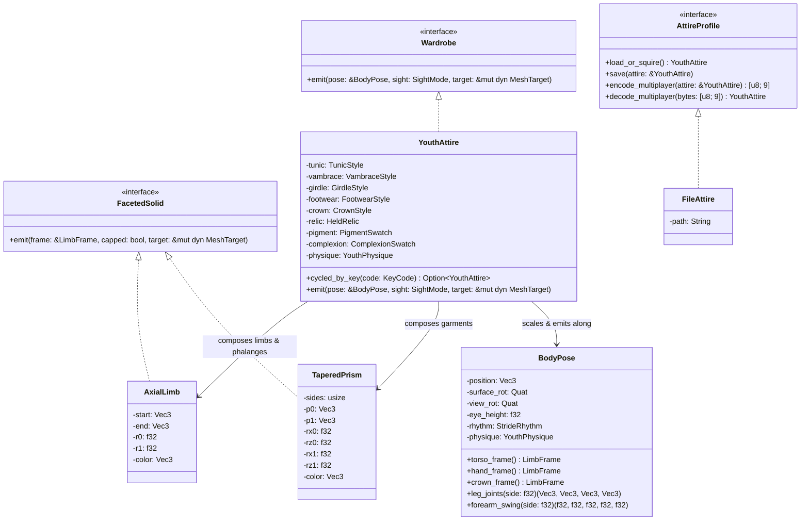

# Character Concept & Wardrobe Customization Reference

In **Low-Cube**, the player avatar is embodied as a **faceted low-poly medieval youth / squire** (*Junger Knappe / Lehrling*, ~15–18 years old). Designed to harmonize with the non-textured, flat-shaded polyhedral world and trees, the character combines **First-Person Body Awareness** (visible hands, forearms, torso, belt, chausses, and boots when looking down) with a complete **Multiplayer & Looking-Glass Mirror** appearance (adding neck, head, hair, or medieval hood).

---

## 1. Visual Concept & Perspectives

| Medieval Youth Archetypes (3rd-Person / Mirror) | First-Person Body & Articulated Hands |
| :---: | :---: |
|  |  |
| *Faceted medieval tunic, belt, chausses, cuffed boots, and headgear.* | *Looking down in First-Person reveals the flat-front doublet, belt, legs, and 5-finger hands.* |

### Dual-Perspective Sight Modes ([`SightMode`](../crates/client/src/attire/crown.rs))

1. **First-Person Sight (`SightMode::FirstPersonSight`)**:
   - The camera sits at the avatar's eye origin (`eye_height = 0.80 m` above the torso center, `1.78 m` above the ground when standing; `1.38 m` when sneaking).
   - **Articulated 5-Finger Hands & Forearms**: Outstretched in the lower peripheral field of view, connected via upper arms to the high shoulder sockets (`shoulder_y = 1.66 m`).
   - **Full Downward Gaze Awareness**: Tilting the view downward reveals the flat-front medieval doublet/jerkin, waist girdle, chausses (hose), knees, muscular calves, and boots stepping across the terrain. The head and hair (`CrownStyle`) are omitted in First-Person so they never obstruct the camera frustum.
2. **Looking-Glass Mirror & Multiplayer Sight (`SightMode::LookingGlassSight`)**:
   - Pressing **`M`** toggles the **Looking-Glass Mirror**, shifting the camera `2.35 m` in front of the avatar looking back at the character.
   - Emits the complete multiplayer peer mesh including the neck, faceted youthful head, ears, nose bridge, eyes, and selected hairstyle or medieval hood ([`CrownStyle`](../crates/client/src/attire/crown.rs)).

---

## 2. Wardrobe Customization & Hotkeys

Players can customize their character live during gameplay using keyboard hotkeys. Every change is immediately persisted to `character.toml` via [`FileAttire`](../crates/client/src/attire/file_attire.rs) and encoded into a compact 9-byte array (`[u8; 9]`) for multiplayer synchronization.

| Hotkey | Category | Domain Object | Available Styles / Swatches |
| :---: | :--- | :--- | :--- |
| **`1`** | **Upper Garment**<br>*(Obergewand)* | [`TunicStyle`](../crates/client/src/attire/garments.rs) | • `0`: **Linen Doublet** *(Leinen-Wams)*<br>• `1`: **Quilted Jerkin** *(Gestepptes Lederwams)*<br>• `2`: **Peasant Shirt** *(Bäuerliches Tunikahemd)* |
| **`2`** | **Forearms & Bracers**<br>*(Unterarme & Armschienen)* | [`VambraceStyle`](../crates/client/src/attire/hands.rs) | • `0`: **Bare Forearms** *(Freie Unterarme)*<br>• `1`: **Rawhide Wraps** *(gekreuzte Rohleder-Wickel)*<br>• `2`: **Splinted Vambraces** *(Vernietete Leder-Armschienen)* |
| **`3`** | **Waist Girdle**<br>*(Gürtel & Gürteltasche)* | [`GirdleStyle`](../crates/client/src/attire/garments.rs) | • `0`: **Knotted Cord** *(Schlichter Ledergurt)*<br>• `1`: **Pouched Girdle** *(Gürtel mit Ledertasche)*<br>• `2`: **Unbelted Waist** *(Ohne Gürtel)* |
| **`4`** | **Chausses & Footwear**<br>*(Beinlinge & Schuhwerk)* | [`FootwearStyle`](../crates/client/src/attire/footwear.rs) | • `0`: **CuffedBoots** *(Stulpenstiefel)*<br>• `1`: **LacedBoots** *(Geschnürte Halbstiefel)*<br>• `2`: **Turnshoes** *(Mittelalterliche Wendeschuhe)* |
| **`5`** | **Hair & Headgear**<br>*(Frisur & Kopfbedeckung)* | [`CrownStyle`](../crates/client/src/attire/crown.rs) | • `0`: **Tousled Mop** *(Strubbeliger Schopf)*<br>• `1`: **Squire Crop** *(Kurzer Knappen-Schnitt)*<br>• `2`: **Medieval Gugel** *(Kapuze mit Schulterkragen)*<br>• `3`: **Merchant Cap** *(Mittelalterliches Barett)* |
| **`6`** | **Natural Cloth Dye**<br>*(Stoff- & Gewandfarbe)* | [`PigmentSwatch`](../crates/client/src/attire/palette.rs) | • `0`: **Unbleached Linen** *(Ungebleichtes Leinen)*<br>• `1`: **Forest Moss** *(Waldmoos-Grün)*<br>• `2`: **Madder Crimson** *(Krapp-Karminrot)*<br>• `3`: **Woad Indigo** *(Färberwaid-Indigoblau)*<br>• `4`: **Ochre Gold** *(Ockergold)*<br>• `5`: **Saddle Hide** *(Sattelleder-Braun)*<br>• `6`: **Charcoal Slate** *(Kohlenschiefer-Grau)*<br>• `7`: **Russet Bark** *(Rostbraun)* |
| **`7`** | **Complexion & Stature**<br>*(Hautton & Körperbau)* | [`ComplexionSwatch`](../crates/client/src/attire/palette.rs)<br>[`YouthPhysique`](../crates/client/src/attire/palette.rs) | **Skin Tones**: `0` Birch, `1` Meadow, `2` Amber, `3` Umber<br>**Stature Builds**: `0` Slender Squire (`0.94×`), `1` Agile Scout (`1.00×`), `2` Sturdy Apprentice (`1.08×`) |
| **`8` / `H`** | **Held Relic**<br>*(Gehaltenes Objekt)* | [`HeldRelic`](../crates/client/src/attire/relic.rs) | • `0`: **Empty Palm** *(Offene Hand)*<br>• `1`: **Quarried Stone** *(Behauener Steinblock)*<br>• `2`: **Timber Torch** *(Brennende Holzfackel)*<br>• `3`: **Wooden Mallet** *(Zimmermannshammer)* |
| **`M`** | **Looking-Glass Mirror**<br>*(Spiegel-Ansicht)* | [`SightMode`](../crates/client/src/attire/crown.rs) | Toggles between First-Person view (`FirstPersonSight`) and frontal 3rd-Person mirror inspection (`LookingGlassSight`). |

---

## 3. Biomechanics, Proportions & Kinematics

### 3.1 Hand, Wrist & Forearm Alignment ([`VambraceStyle::emit`](../crates/client/src/attire/hands.rs))
- **Collinear Forearm-to-Wrist Frame**: The local coordinate frame (`arm_frame`) is aligned directly along the vector from `elbow_world` to `wrist_world`. This guarantees that the wrist never kinks outward during walking or running swings.
- **Natural Anatomical Wrist Inflection**: From the wrist joint (`Z = 0`), the palm (`metacarpus`) tilts slightly upward (`+0.008 m`) and inward (`-side * 0.007 m`) with a wider palm base so the hand reads clearly as a distinct anatomical structure rather than a flat continuation of the forearm.
- **Zero Z-Fighting Bracer Partition**: Forearm geometry is partitioned into non-overlapping axial segments (`BareForearms`, `RawhideWraps`, `SplintedVambraces`), preventing underlying skin facets from bleeding through leather wraps or bracer cuffs.
- **Gait-Responsive Finger Flexion ([`BodyPose::finger_curl`](../crates/client/src/attire/pose.rs))**:
  - **Standing (`0.18`) & Walking (`0.25`)**: Hands stay low and relaxed with lightly open fingers.
  - **Sprinting (`0.96`)**: Forearms pull closer and higher while all 5 three-jointed fingers curl into an athletic running fist.
  - **Holding a Relic (`0.88`)**: Right-hand fingers wrap firmly around the held stone, torch, or mallet.

### 3.2 3D Leg Joint Chain & Sculpted Proportions ([`BodyPose::leg_joints`](../crates/client/src/attire/pose.rs), [`FootwearStyle::emit`](../crates/client/src/attire/footwear.rs))
- **Constant-Length Trigonometric Bone Chain**: Thigh (`0.37 m`) and shin (`0.36 m`) lengths remain strictly constant across all stride phases, preventing telescopic bone stretching when legs lift.
- **Human Swing-Through vs. Forward Stride Extension**:
  - Knee flexion (`pass = (phase + 0.25).cos().max(0.0)`) peaks as the foot swings underneath the hip to clear the ground, then **extends forward** as the leg reaches out to step (`theta_shin > 0`), so the shin and boot step out visibly in front of the knee.
  - Subtle 3D lateral knee flare (`knee_out`) and ankle tuck (`ankle_in`) ensure knee articulation remains three-dimensionally legible when looking down from First-Person.
- **Athletic Silhouette & Proportions**:
  - **Upper Torso & Wide Hips**: Forward-sloped doublet with a wide hip skirt (`0.168 m` hip hem, `0.106 m` waist, `0.118 m` chest) recessed at the collarbone so the chest never eclipses the waist or hips when looking down.
  - **Sculpted Legs**: Wide-set hip sockets (`±0.096 m`) with full upper thighs (`0.092 -> 0.068 m`), contrasting knee garter bands (`0.069 -> 0.066 m`), a pronounced gastrocnemius **calf muscle belly** (`0.066 -> 0.076 m`), and sturdy medieval boot shafts (`0.076 -> 0.062 m`) and feet (`0.070 -> 0.056 m`).

### 3.3 Physical Body Envelope ([`BodyEnvelope`](../crates/client/src/envelope.rs))
- Wraps the planetary surface constraint with an 8-point horizontal octagon (`radius = 0.26 m`) around the avatar's waist and chest (`+0.35 m` above feet).
- Prevents the First-Person camera and upper torso from clipping into `1×1×1` solid walls or tree trunks while preserving smooth lateral wall-sliding.

---

## 4. Profile Persistence (`character.toml`) & Multiplayer Codec

Whenever a wardrobe key (`1`–`8` or `H`) is pressed, [`FileAttire`](../crates/client/src/attire/file_attire.rs) saves the configuration to `character.toml` in the working directory:

```toml
# Medieval Youth Avatar Profile
[character]
tunic = 0
vambrace = 1
girdle = 0
footwear = 0
crown = 0
relic = 0
pigment = 0
complexion = 0
physique = 0
```

For network transmission between multiplayer peers, [`AttireProfile::encode_multiplayer`](../crates/client/src/attire/file_attire.rs) serializes the entire appearance into a deterministic 9-byte packet (`[u8; 9]`), which peers decode into an immutable [`YouthAttire`](../crates/client/src/attire/mod.rs) value object and render via `SightMode::LookingGlassSight`.

---

## 5. Architectural Design (Pure OOP & Elegant Objects)

In compliance with [AGENTS.md](../AGENTS.md), all character and wardrobe entities are immutable domain objects that communicate via trait interfaces (`Wardrobe`, `AttireProfile`, `FacetedSolid`) without getters, setters, or procedural utility classes:


