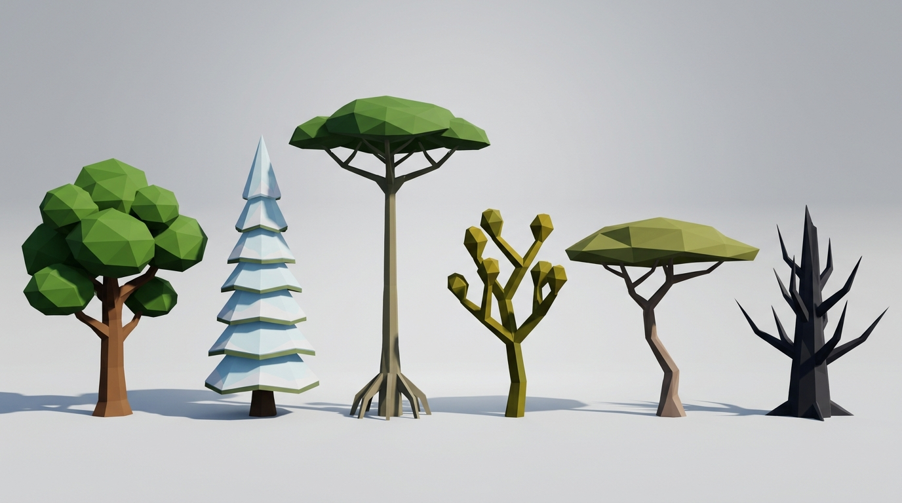
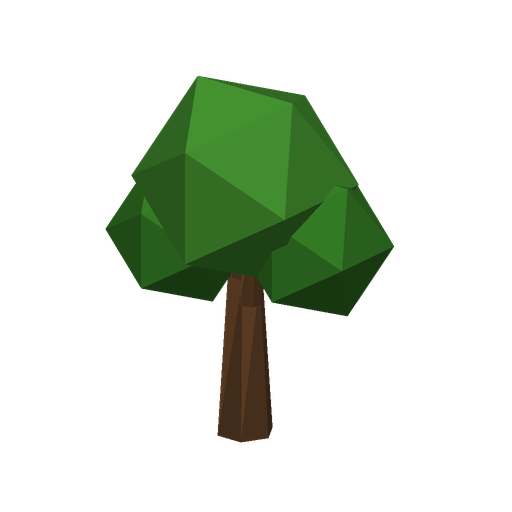
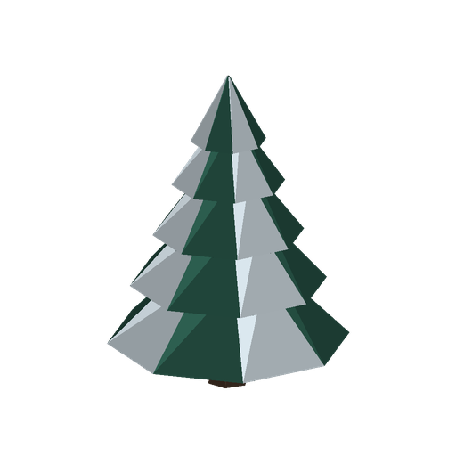
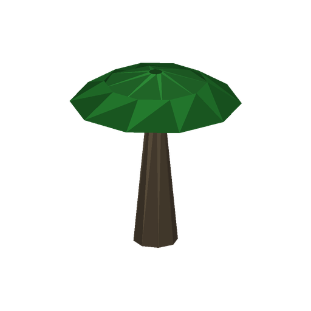
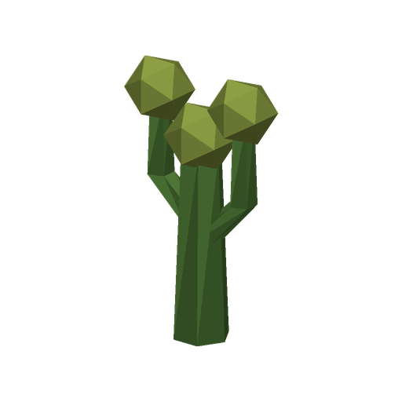
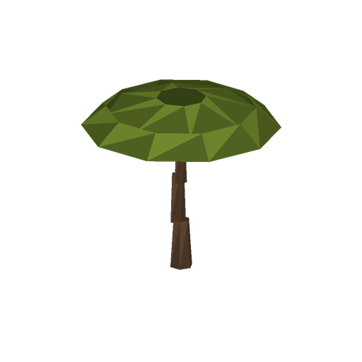
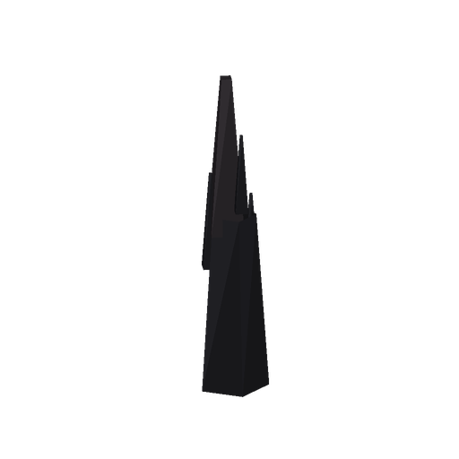
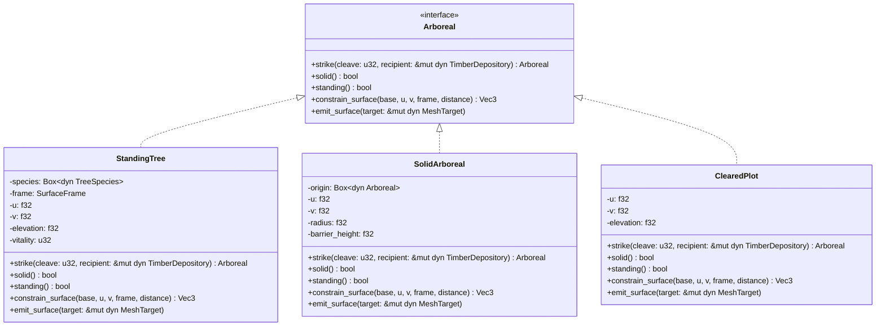

# Tree Catalog & Forestry Reference

In **Low-Cube**, trees are **not composed of voxel blocks**. They are represented as coherent, flat-shaded **low-poly geometric entities** that are felled at the trunk like real trees, matching the game's non-textured, faceted low-poly aesthetic.

Each of the six cubic planetary faces ([`ClimateZone`](../crates/world/src/topology/climate_zone.rs)) features a distinct, climate-adapted tree species with specialized geometric architecture, wood properties, and ecological harvesting yields.

---

## 1. Planetary Climate Showcase



*From left to right: Temperate Deciduous Oak, Arctic Alpine Pine, Jungle Buttressed Emergent, Desert Joshua Tree, Steppe Umbrella Acacia, and Volcanic Charred Basalt Spire.*

---

## 2. Tree Species Catalog (The 6 Planetary Faces)

| Climate Zone | Tree ID / Species | Geometry & Architecture | Resource Drops | Rendered Mesh |
|---|---|---|---|:---:|
| **Temperate (+Y)**<br>`Temperate` | `temperate_oak`<br>**Temperate Oak**<br>*(Gemäßigte Eiche)* | 6-sided prismatic trunk with branching fork; foliage formed by nested faceted icosahedral clumps. | • Standard Lumber<br>• Saplings<br>• Twigs & Apples |  |
| **Arctic (-X)**<br>`Arctic` | `arctic_pine`<br>**Arctic Pine**<br>*(Schnee-Tanne)* | Stepped conical skirt tiers with steep 60° slopes for snow shedding; upper snow facets with dark pine under-shading. | • Dense Hardwood<br>• Pine Cones<br>• Resin (combustible) |  |
| **Jungle (+Z)**<br>`Jungle` | `jungle_canopy`<br>**Jungle Emergent**<br>*(Urwald-Riese)* | Towering column supported by 4 flaring buttress roots (`Wedge` roots); broad, flat parasol canopy at high altitude. | • Tropical Hardwood<br>• Vines / Lianas<br>• Jungle Fruits |  |
| **Desert (+X)**<br>`Desert` | `desert_succulent`<br>**Joshua Tree**<br>*(Wüsten-Sukkulente)* | Segmented, angled columnar arms with succulent green prisms and crystalline terminal pods. | • Soft Fibrous Wood<br>• Plant Water (Hydration)<br>• Cacti Fibers |  |
| **Steppe (-Z)**<br>`Steppe` | `steppe_acacia`<br>**Umbrella Acacia**<br>*(Schirmakazie)* | Angled, knobby zig-zag trunk branching into a wide, horizontally flattened savanna canopy disc. | • Tough Drywood<br>• Acacia Pods<br>• Bark Strips |  |
| **Volcanic (-Y)**<br>`Volcanic` | `volcanic_spire`<br>**Basalt Spire**<br>*(Asche-Skelett)* | Leafless, jagged obsidian and basalt spire with crystalline splinter needles and ash-tinted edges. | • Fireproof Basaltwood<br>• Charcoal & Ash<br>• Sulfur Crystals |  |

---

---

## 3. Direct Harvesting Lifecycle & Physical Collision

```
[Standing Tree (Solid Trunk Collider)] ──(3–4 Axe Strikes)──> [Shatter Burst & Direct Inventory Deposit] ──> [Cleared Plot (Vanished)]
```

### 1. Physical Trunk Collision
- **Solid Obstacle**: Standing trees are solid physical obstacles. Avatars cannot run through the trunk (`constrain_surface` blocks horizontal penetration within trunk radius $r = 0.65\,\text{m}$).
- **Smooth Deflection**: Strafing against a tree smoothly deflects the avatar around the trunk contour.

### 2. Strikes & Haptic Feedback
- **Axe Strikes**: Each axe blow triggers a crisp micro-wobble and emits directional low-poly wood chips.
- **Durability**: Calibrated to species density (e.g. 2–4 strikes).

### 3. Fatal Strike & Instant Vanishing (No Stumps, No Logs)
- **Instant Vanishing**: At 0 durability, the tree **disappears completely** without leaving stumps or fallen logs behind.
- **Audio-Visual Feedback**: The canopy and trunk break apart with a satisfying "crack" sound and a brief burst of low-poly wood and leaf particles.
- **Direct Inventory Deposit**: All harvested yields (Lumber, Saplings, Fruit, Water, Resin) are placed **directly into the player's inventory** immediately. Floating pickup indicators (+4 Wood, +2 Twigs) fly toward the avatar.
- **Null Object (`ClearedPlot`)**: The entity transitions to a `ClearedPlot` (Null Object pattern) which is non-solid and clears the terrain for building.

---

## 4. Architectural Design (Pure OOP & Elegant Objects)

In accordance with [AGENTS.md](../AGENTS.md), forestry entities communicate through declarative messages and immutable state transitions:



- **`Arboreal` Interface**: The root abstraction representing any forest entity.
- **`SolidArboreal` Decorator**: Decorates any `Arboreal` to enforce physical trunk collision constraint ($r = 0.65\,\text{m}$), elevating surface height dynamically to block penetration.
- **Direct Inventory Interaction**: The `strike` method dispatches harvested yield directly to `recipient: &mut dyn TimberDepository`. When vitality reaches 0, it returns a `ClearedPlot`.
- **Zero Stumps or Half-Born States**: `ClearedPlot` serves as the clean Null Object without `null` or `Option` abuses.
- **Pure OOP Decorator Chain (`PlantingGround`)**:
  - `SurfaceGround`: Base ground resolving face height.
  - `FullCubeGround`: Decorates ground to guarantee flat, unsloped Full-Cubes.
  - `WoodlandGround`: Decorates ground to modulate coherent macro-density (dense forest, solitary trees, open clearings).
  - `MeridianGround`: Decorates ground to keep equatorial transit trails clear.
  - `SpawnSanctuaryGround`: Decorates ground to preserve the player spawn zone.
- **Zero Procedural Workers**: No `TreeManager`, `HarvestController`, or static collision utils.

---

## 6. Tree Catalog CLI Tool

The procedural tree meshes and snapshots are generated via [`scripts/tree_catalog.py`](../scripts/tree_catalog.py):

```bash
# List all tree models and climate zones
./scripts/tree_catalog.py list

# Render a specific tree
./scripts/tree_catalog.py render temperate_oak docs/images/trees/temperate_oak.png

# Re-render all catalog models
./scripts/tree_catalog.py render-all
```
